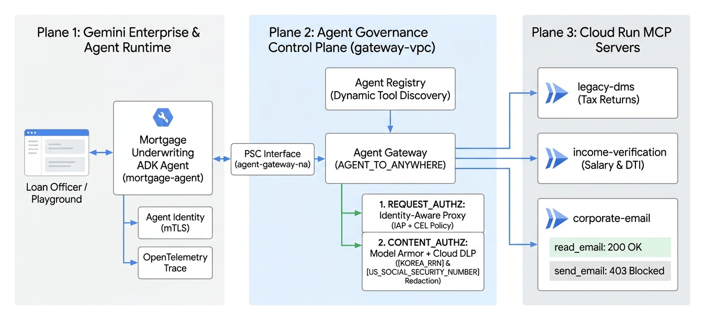
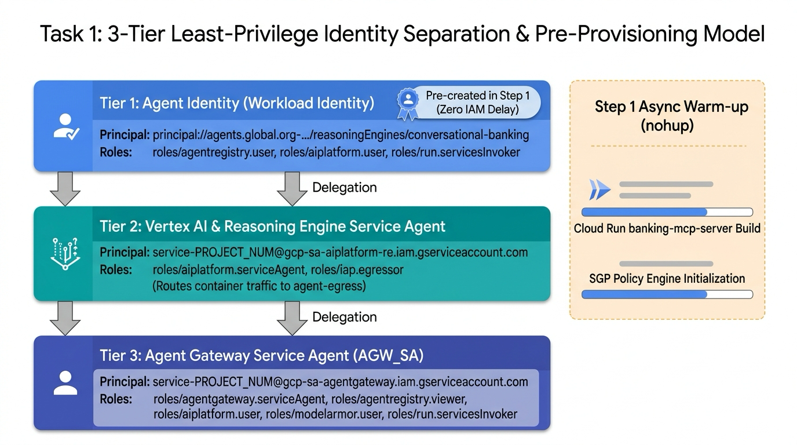
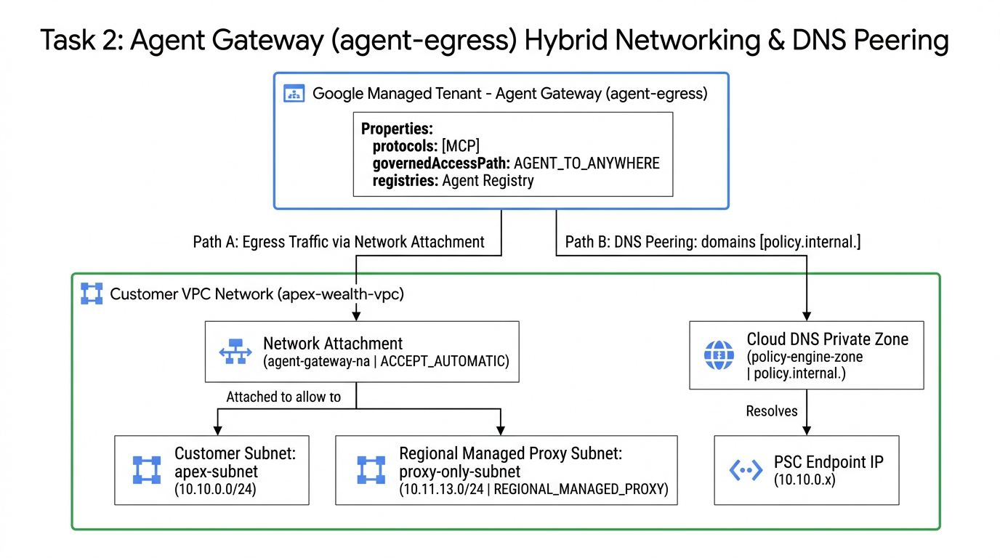

# Gemini Enterprise와 Agent Gateway, SGP를 활용한 자율형 AI 에이전트 보안 거버넌스

## 개요

대규모 언어 모델(LLM) 기반의 자율형 AI 에이전트는 스스로 추론하고 워크플로를 오케스트레이션하며, 계좌 이체 API나 핵심 데이터베이스 같은 엔터프라이즈 백엔드 도구를 직접 호출할 수 있습니다. 하지만 에이전트에게 백엔드 시스템에 대한 직접적인 네트워크 접근 권한을 부여하면 프롬프트 인젝션(Prompt Injection), 모델 환각(Hallucination), 비인가 고액 거래로 인한 보안 및 금융 컴플라이언스 리스크가 발생합니다.

이 실습에서는 에이펙스 자산운용(Apex Asset Management)의 금융 보안 시나리오를 바탕으로, **에이전트 애플리케이션 코드를 수정하지 않고 네트워크 경계(Network Boundary)에서 자연어 기반의 비즈니스 규정을 실시간으로 강제하는 엔터프라이즈 거버넌스 아키텍처**를 직접 구축합니다. Gemini Enterprise Agent Runtime에서 동작하는 대화형 뱅킹 에이전트(`gemini-3.8-flash`, Global 엔드포인트)가 Google Cloud Agent Gateway(`agent-egress`)와 시맨틱 거버넌스 정책(Semantic Governance Policies, SGP)을 경유하여 Cloud Run 기반의 뱅킹 MCP(Model Context Protocol) 서버를 호출하도록 구성합니다.

에이전트 내부의 시스템 프롬프트만으로는 우회 공격이나 런타임 오작동을 완벽히 통제하기 어렵습니다. Agent Gateway와 SGP를 결합하면 모든 아웃바운드 도구 호출을 네트워크 경계에서 가로채어 **"1회 이체 금액이 100만 원(`amount <= 1000.0`)을 초과하는 모든 송금 요청은 차단한다"**와 같은 자연어 비즈니스 정책을 코드 변경 없이 강제하고 Cloud Logging에 감사 로그를 기록할 수 있습니다.

### 전체 아키텍처 및 트래픽 흐름도

아래 아키텍처 다이어그램은 이 실습에서 구축할 3개의 테넌트/네트워크 영역(Zone 1: Gemini Enterprise 에이전트 런타임 테넌트, Zone 2: 고객 VPC 및 Agent Registry 컨트롤 플레인, Zone 3: Google 관리형 SGP 테넌트) 간의 전체 상호작용과 트래픽 흐름을 보여줍니다.

| 단계 | 구성 요소 | 역할 및 트래픽 흐름 |
| :--- | :--- | :--- |
| 1. 사용자 요청 | 금융 고객 김민준 (`CUST005`) → Gemini Enterprise 에이전트 | 3-Turn 대화형 요청 전달 (`gemini-3.8-flash`, Global API) |
| 2. 호출 가로채기 | Gemini Enterprise 에이전트 → Agent Gateway (`agent-egress`) | 아웃바운드 MCP 도구 호출을 네트워크 경계에서 가로채기 및 TLS 복호화 |
| 3. 카탈로그 검증 | Agent Registry ↔ Agent Gateway | 허가된 MCP 도구 스키마 및 시스템 API Allowlist 확인 (`roles/iap.egressor`) |
| 4. 정책 심사 (PSC) | Agent Gateway → SGP 정책 엔진 (`policy.internal.`) | PSC 사설망을 통해 1회 이체 한도(100만 원 / `USD 1000`) 초과 여부 실시간 심사 |
| 5. 백엔드 실행 및 감사 | Agent Gateway → Cloud Run (`banking-mcp-server`) | `ALLOW` 판정 시 Cloud Run MCP 서버로 전달, `DENY` 시 차단 및 Cloud Logging 기록 |

### 학습 목표

이 실습에서는 Google Cloud Shell을 사용하여 다음 작업을 수행하고, 각 구성 요소를 자사 엔터프라이즈 환경에 적용하는 방법을 익힙니다.

1. Agent Gateway(`agent-egress`) 구성을 위한 필수 Google Cloud API 활성화 및 3-계층 서비스/에이전트 ID(`roles/agentgateway.serviceAgent`, `AGENT_IDENTITY`) 최소 권한 분리 구성
2. 리전 관리형 프록시 전용 서브넷(`proxy-only-subnet`), Network Attachment(`agent-gateway-na`), `AGENT_TO_ANYWHERE` 모드의 Agent Gateway 배포
3. Google Cloud Run에 에이펙스 자산운용의 4가지 금융 도구를 제공하는 뱅킹 MCP 서버(`banking-mcp-server`) 컨테이너 빌드 및 배포
4. Agent Registry에 뱅킹 MCP 도구 명세(`toolspec.json`) 및 Gemini Enterprise Global API(`https://aiplatform.googleapis.com`)를 포함한 시스템 엔드포인트 등록과 IAP Egress(`roles/iap.egressor`) 권한 부여
5. Google ADK(Agent Development Kit)로 구현된 대화형 뱅킹 에이전트(`gemini-3.8-flash`, `GOOGLE_CLOUD_LOCATION=global`)를 Gemini Enterprise Agent Runtime에 비동기(`--no-wait`)로 배포
6. 백그라운드에서 에이전트가 배포되는 동안 SGP 정책 엔진 활성화, Private Service Connect(PSC) 엔드포인트(`sgp-psc-endpoint`) 및 프라이빗 Cloud DNS(`policy.internal.`) 구성
7. Service Extensions(`AuthzExtension`), 네트워크 보안 인가 정책(`AuthzPolicy`), 100만 원 초과 송금을 차단하는 자연어 시맨틱 거버넌스 정책(`high-value-limit`) 생성
8. Cloud Shell에서 3-Turn 금융 거래 시나리오(본인 확인, 5만 원 소액 이체 `ALLOW`, 200만 원 고액 이체 `DENY`) 실행 및 Cloud Logging 감사 로그 확인

### 사전 요구사항

* Google Cloud 콘솔 및 Cloud Shell 기본 사용법
* VPC 서브넷, Private Service Connect(PSC), Cloud DNS 등 Google Cloud 네트워킹 기초 개념
* Python 기반 AI 에이전트(ADK) 및 Model Context Protocol(MCP)의 기본 동작 원리

## 실습 환경 설정 및 요구사항

### 실습 시작 및 Google Cloud 콘솔 로그인

1. 화면 좌측 상단의 **Start Lab** 버튼을 클릭합니다. 실습이 시작되면 임시 Google Cloud 프로젝트와 로그인 자격 증명(**Username**, **Password**)이 발급됩니다.
2. 개인 계정과의 충돌 및 의도치 않은 과금을 방지하기 위해 반드시 브라우저의 **시크릿 창**(Incognito Window)에서 실습을 진행합니다.
3. 좌측 패널의 **Open Google Cloud console** 버튼을 우클릭하여 시크릿 창에서 열고, 발급된 **Username**과 **Password**를 복사하여 로그인합니다.
4. 약관 동의 화면이 나타나면 동의 후 다음으로 진행합니다. 임시 계정이므로 복구 옵션이나 2단계 인증은 설정하지 않습니다.

<ql-warningbox><strong>주의:</strong> 실습을 완전히 마칠 때까지 좌측 상단의 <strong>End Lab</strong> 버튼을 클릭하지 마세요. <strong>End Lab</strong>을 클릭하면 진행 중인 작업과 임시 Google Cloud 프로젝트가 즉시 삭제됩니다.</ql-warningbox>

### Cloud Shell 활성화

Google Cloud 콘솔 우측 상단 툴바에서 **Activate Cloud Shell** 아이콘을 클릭하여 Cloud Shell 터미널을 엽니다. 안내 창이 나타나면 **Continue**와 **Authorize**를 차례대로 클릭합니다.

### 실습 리포지토리 및 CLI 도구 준비

실습을 시작하면 사전 프로비저닝 스크립트(`terraform/main.tf`)가 백그라운드에서 실행되어 필수 Google Cloud API, 전용 VPC 네트워크(`apex-wealth-vpc`), 리전 서브넷(`apex-subnet`, `10.10.0.0/24`), 리전 관리형 프록시 전용 서브넷(`proxy-only-subnet`, `10.11.13.0/24`), 프라이빗 Cloud DNS 영역(`policy-engine-zone`), PSC 내부 고정 IP(`sgp-psc-ip`) 및 기본 서비스 에이전트 IAM 권한을 자동으로 준비합니다.

Cloud Shell 터미널이 열리면 아래 명령어를 순서대로 실행하여 환경을 준비합니다.

1. 현재 로그인된 계정과 활성화된 프로젝트 ID를 확인합니다.

<ql-code-block language="bash">
gcloud auth list
gcloud config list project
</ql-code-block>

2. 프로젝트 ID가 비어 있다면 좌측 실습 안내 패널에 표시된 **Project ID**를 설정합니다.

<ql-code-block language="bash" templated>
gcloud config set project {{{project_0.project_id|PROJECT_ID}}}
</ql-code-block>

3. Cloud Shell 홈 디렉터리(`$HOME`)에 실습 코드 리포지토리를 복제하고 작업 폴더로 이동합니다.

<ql-code-block language="bash">
cd ~
git clone https://github.com/wxdxh/agent-gateway-sgp.git
cd ~/agent-gateway-sgp
chmod +x *.sh
</ql-code-block>

4. Gemini Enterprise Agent Runtime 패키징 및 배포에 사용하는 `uv`와 `google-agents-cli`를 설치합니다.

<ql-code-block language="bash">
curl -LsSf https://astral.sh/uv/install.sh | sh
export PATH="$HOME/.local/bin:$PATH"
echo 'export PATH="$HOME/.local/bin:$PATH"' >> ~/.bashrc

uv tool install google-agents-cli
agents-cli --version
</ql-code-block>

5. 공통 환경 변수 스크립트(`env.sh`)를 로드하여 프로젝트 메타데이터와 VPC(`apex-wealth-vpc`), 서브넷(`apex-subnet`) 정보가 정상적으로 불러와지는지 확인합니다.

<ql-code-block language="bash">
cd ~/agent-gateway-sgp
source env.sh
</ql-code-block>

정상적으로 로드되면 다음과 같은 환경 정보가 출력됩니다.

<ql-code-block output>
Project ID:     qwiklabs-gcp-xx-xxxxxxxxxxxx
Project Number: 1080321871308
Location:       us-central1
VPC Network:    apex-wealth-vpc
VPC Subnet:     apex-subnet
Agent GW SA:    serviceAccount:service-1080321871308@gcp-sa-agentgateway.iam.gserviceaccount.com
</ql-code-block>

#### `env.sh` 스크립트 내부 동작 상세 설명

`source env.sh`를 실행하면 이후 모든 스크립트(`01`~`08`)와 CLI 명령에서 공통으로 참조하는 환경 변수가 현재 셸 세션에 설정됩니다. 각 변수의 의미와 탐색 원리는 다음과 같습니다.

| 환경 변수 | 설정 방식 및 값 예시 | 아키텍처상의 역할 |
| :--- | :--- | :--- |
| `PROJECT_ID` | `gcloud config get-value project` | 리소스가 배포될 대상 Google Cloud 프로젝트 ID입니다. |
| `PROJECT_NUM` | `gcloud projects describe ... --format="value(projectNumber)"` | Google 관리형 서비스 에이전트 이메일(`service-${PROJECT_NUM}@...`)과 AuthzPolicy 리소스 경로 구성에 사용되는 고유 프로젝트 번호입니다. |
| `NETWORK_NAME` / `SUBNET_NAME` | `apex-wealth-vpc` / `apex-subnet` 자동 감지 | Agent Gateway의 Network Attachment와 SGP PSC 엔드포인트가 배치될 고객 VPC 네트워크 및 서브넷(`10.10.0.0/24`)입니다. |
| `LOCATION` | `apex-subnet`이 위치한 리전 자동 감지 (기본값: `us-central1`) | Agent Gateway, Agent Registry, Cloud Run, SGP 정책 엔진이 배포될 리전입니다. (단, Gemini 모델 추론은 Global 엔드포인트를 사용합니다.) |
| `AGW_SA` | `serviceAccount:service-${PROJECT_NUM}@gcp-sa-agentgateway.iam.gserviceaccount.com` | `networkservices.googleapis.com` API를 통해 생성되는 **Agent Gateway 전용 Google 관리형 서비스 에이전트**입니다. |

<ql-infobox><strong>참고:</strong> 실습 도중 Cloud Shell 세션이 재연결되더라도 <code>$HOME/agent-gateway-sgp</code> 디렉터리와 <code>.env.runtime</code> 파일은 유지됩니다. 터미널이 재시작된 경우 <code>cd ~/agent-gateway-sgp &amp;&amp; source env.sh &amp;&amp; [[ -f .env.runtime ]] &amp;&amp; source .env.runtime</code> 명령어를 실행하면 이어서 진행할 수 있습니다.</ql-infobox>

## 작업 1. 필수 Google Cloud API 확인, 서비스 에이전트 IAM 구성 및 백그라운드 예열

엔터프라이즈 에이전트 보안 거버넌스 아키텍처에서는 단일 서비스 계정에 과도한 권한을 몰아주는 대신, **플랫폼·게이트웨이·에이전트 실행 주체의 ID를 3계층으로 분리하여 최소 권한(Least Privilege)을 부여**합니다. 첫 번째 작업에서는 실습에 사용되는 핵심 ID의 역할을 이해하고 IAM 권한을 구성합니다.

| 구분 | 주체 (Principal / Service Account) | 핵심 역할 및 필요 권한 |
| :--- | :--- | :--- |
| **1. Agent Gateway 서비스 에이전트** (`AGW_SA`) | `service-${PROJECT_NUM}@gcp-sa-agentgateway.iam.gserviceaccount.com` | 에이전트의 아웃바운드 트래픽을 중계하고 Agent Registry(`roles/agentregistry.viewer`) 조회 및 SGP 정책 엔진(`roles/aiplatform.user`) 심사를 요청합니다. |
| **2. Vertex AI 서비스 에이전트** | `service-${PROJECT_NUM}@gcp-sa-aiplatform.iam.gserviceaccount.com` | Gemini Enterprise Agent Runtime을 생성하고 해당 런타임의 아웃바운드 경로에 `agent-egress` 게이트웨이를 연결(`roles/aiplatform.serviceAgent`)합니다. |
| **3. 에이전트 고유 ID (Agent Identity)** | `principal://agents.global.org-.../reasoningEngines/...` | 범용 서비스 계정 대신 `conversational-banking` 에이전트 인스턴스에만 발급되는 고유 ID로, 허가된 도구 조회(`roles/agentregistry.user`) 및 모델 추론 권한만 가집니다. |

### `./01-setup-env.sh` 스크립트 내부 동작 상세 분석

`./01-setup-env.sh` 스크립트는 내부적으로 다음 4단계의 명령을 순차 실행합니다. 각 단계에서 어떤 명령어가 실행되고 왜 필요한지 살펴봅니다.

<ql-code-block output>
# [단계 1] 필수 Google Cloud API 19종 활성화 확인
gcloud services enable \
  compute.googleapis.com networksecurity.googleapis.com networkservices.googleapis.com \
  dns.googleapis.com iam.googleapis.com iap.googleapis.com agentregistry.googleapis.com \
  aiplatform.googleapis.com run.googleapis.com cloudbuild.googleapis.com \
  artifactregistry.googleapis.com storage.googleapis.com modelarmor.googleapis.com \
  telemetry.googleapis.com cloudtrace.googleapis.com logging.googleapis.com \
  cloudapiregistry.googleapis.com agentidentity.googleapis.com serviceextensions.googleapis.com \
  --project="${PROJECT_ID}"

# [단계 2] Google 관리형 서비스 에이전트 프로비저닝 및 IAM 역할 바인딩
gcloud beta services identity create --service=networkservices.googleapis.com --project="${PROJECT_ID}"
gcloud beta services identity create --service=aiplatform.googleapis.com --project="${PROJECT_ID}"

for ROLE in "roles/agentgateway.serviceAgent" "roles/aiplatform.user" "roles/modelarmor.user" "roles/agentregistry.viewer"; do
  gcloud projects add-iam-policy-binding "${PROJECT_ID}" --member="${AGW_SA}" --role="${ROLE}" --condition=None
done

# [단계 3] 에이전트 고유 ID(AGENT_IDENTITY) 선행 발급 및 최소 권한 사전 바인딩
curl -X POST "https://${LOCATION}-aiplatform.googleapis.com/v1beta1/projects/${PROJECT_ID}/locations/${LOCATION}/reasoningEngines" \
  -H "Authorization: Bearer $(gcloud auth print-access-token)" \
  -H "Content-Type: application/json" \
  -d '{"displayName": "conversational-banking", "spec": {"identityType": "AGENT_IDENTITY"}}'

# 발급된 principal://agents.global.org-.../reasoningEngines/... 에 사전 권한 부여
for ROLE in "roles/agentregistry.viewer" "roles/agentregistry.user" "roles/aiplatform.user" ...; do
  gcloud projects add-iam-policy-binding "${PROJECT_ID}" --member="principal://${EFFECTIVE_ID}" --role="${ROLE}"
done

# [단계 4] 실습 대기 시간 단축을 위한 백그라운드 예열 (Warm-up)
nohup gcloud run deploy banking-mcp-server --source=./banking-mcp-server ... >/tmp/banking-mcp-warmup.log 2>&1 &
nohup gcloud beta ai semantic-governance-policy-engine update --location="${LOCATION}" ... >/tmp/sgp-engine-warmup.log 2>&1 &
</ql-code-block>

* **단계 1 (필수 API 19종 활성화)**: Agent Gateway(`networkservices`), AuthzPolicy(`networksecurity`), Agent Identity(`agentidentity`), Service Extensions(`serviceextensions`), IAP Egress 제어(`iap`) 등 거버넌스 스택을 구성하는 API들을 활성화합니다.
* **단계 2 (관리형 서비스 에이전트 생성 및 권한 부여)**: `gcloud beta services identity create` 명령으로 프로젝트 전용 Google 관리형 서비스 에이전트를 깨우고(Identity Provisioning), `AGW_SA`와 Vertex AI 서비스 에이전트에 프로젝트 IAM 역할을 바인딩합니다.
* **단계 3 (에이전트 고유 ID `principal://...` 선행 생성)**: `reasoningEngines` REST API에 소스 코드 없이 `{"identityType": "AGENT_IDENTITY"}`만 지정하여 빈 Reasoning Engine 리소스를 먼저 생성합니다. 이렇게 하면 고유 ID(`principal://...`)가 즉시 발급되어 IAM 권한을 미리 부여할 수 있으므로, 이후 작업 5에서 실제 에이전트 컨테이너를 배포(`agents-cli deploy`)할 때 **글로벌 IAM 권한 전파 지연(Propagation Delay, 통상 1~2분)으로 인한 초기 부팅 실패를 원천 방지**합니다.
* **단계 4 (백그라운드 리소스 예열)**: 학습자가 작업 2의 네트워킹 구성을 진행하는 동안 백그라운드(`nohup ... &`)에서 Cloud Run 뱅킹 MCP 서버 컨테이너 빌드(약 2분 소요)와 SGP 정책 엔진 초기화(약 3분 소요)를 병렬로 시작하여 전체 실습 대기 시간을 단축합니다.

<ql-infobox><strong>자사 인프라 적용 시 핵심 설계 포인트 (CI/CD 파이프라인):</strong> 실제 기업 환경에서 Terraform이나 CI/CD 파이프라인으로 에이전트를 최초 배포할 때도 <strong>단계 3의 선행 ID 발급 패턴</strong>이 매우 유용합니다. 인프라 배포 단계(Terraform)에서 빈 Reasoning Engine(<code>identityType: AGENT_IDENTITY</code>)과 IAM 바인딩을 먼저 생성해 두고, 애플리케이션 배포 단계(GitHub Actions / Cloud Build)에서 <code>agents-cli deploy</code>로 코드만 업데이트하면, 보안팀의 IAM 승인 절차와 개발팀의 코드 배포 주기를 깔끔하게 분리(Decoupling)할 수 있습니다.</ql-infobox>

### 환경 초기화 및 서비스 에이전트 IAM 구성 스크립트 실행

1. Cloud Shell에서 아래 명령어를 실행하여 `01-setup-env.sh` 스크립트를 실행합니다.

<ql-code-block language="bash">
cd ~/agent-gateway-sgp
source env.sh
./01-setup-env.sh
</ql-code-block>

2. 스크립트 실행이 완료되면 Agent Gateway 서비스 에이전트(`AGW_SA`)에 에이전트 트래픽 중계 및 정책 심사에 필요한 4가지 핵심 IAM 역할(`roles/agentgateway.serviceAgent`, `roles/aiplatform.user`, `roles/modelarmor.user`, `roles/agentregistry.viewer`)이 정상적으로 바인딩되었는지 직접 확인합니다.

<ql-code-block language="bash">
gcloud projects get-iam-policy "${PROJECT_ID}" \
  --flatten="bindings[].members" \
  --filter="bindings.members:${AGW_SA}" \
  --format="table(bindings.role)"
</ql-code-block>

## 작업 2. Agent Gateway 네트워크 기반 및 agent-egress 게이트웨이 배포

이 작업에서는 Gemini Enterprise Agent Runtime에서 외부 MCP 서버 및 시스템 API로 나가는 아웃바운드 트래픽을 통제하는 Agent Gateway(`agent-egress`)를 구성합니다.

Agent Gateway는 Google이 관리하는 테넌트 프로젝트에서 실행되는 관리형 Envoy 기반 프록시입니다. 따라서 이 게이트웨이가 **고객의 프라이빗 VPC(`apex-wealth-vpc`) 내부에 있는 SGP 정책 엔진(`policy.internal.`)과 통신**하려면 아래 다이어그램과 같이 Network Attachment(`agent-gateway-na`), 리전 관리형 프록시 전용 서브넷(`proxy-only-subnet`), 그리고 프라이빗 Cloud DNS 피어링(`policy-engine-zone`)의 3가지 네트워크 브리지 요소가 필요합니다.

### 리전 관리형 프록시 서브넷 확인 및 Network Attachment 생성

1. Agent Gateway 내부 Envoy 프록시 인스턴스가 사용할 리전 관리형 프록시 전용 서브넷(`proxy-only-subnet`, `10.11.13.0/24`)과 DNS 피어링용 프라이빗 Cloud DNS 영역(`policy-engine-zone`, `policy.internal.`)이 준비되어 있는지 확인합니다(없는 경우 자동으로 생성합니다).

<ql-code-block language="bash">
cd ~/agent-gateway-sgp
source env.sh

if ! gcloud compute networks subnets describe proxy-only-subnet --region="${LOCATION}" --project="${PROJECT_ID}" &>/dev/null; then
  gcloud compute networks subnets create proxy-only-subnet \
    --network="${NETWORK_NAME}" \
    --region="${LOCATION}" \
    --range="10.11.13.0/24" \
    --purpose=REGIONAL_MANAGED_PROXY \
    --role=ACTIVE \
    --project="${PROJECT_ID}"
fi

if ! gcloud dns managed-zones describe policy-engine-zone --project="${PROJECT_ID}" &>/dev/null; then
  gcloud dns managed-zones create policy-engine-zone \
    --description="Private zone for internal SGP service" \
    --dns-name="policy.internal." \
    --visibility=private \
    --networks="${NETWORK_NAME}" \
    --project="${PROJECT_ID}"
fi
</ql-code-block>

2. Google 관리형 테넌트 프로젝트에서 실행되는 Agent Gateway가 실습 프로젝트의 VPC(`apex-subnet`)로 이그레스 트래픽을 전달할 수 있도록 Network Attachment(`agent-gateway-na`)를 생성합니다.

<ql-code-block language="bash">
gcloud compute network-attachments create agent-gateway-na \
  --region="${LOCATION}" \
  --subnets="${SUBNET_NAME}" \
  --connection-preference=ACCEPT_AUTOMATIC \
  --project="${PROJECT_ID}" || true
</ql-code-block>

### agent-egress 게이트웨이 구성 파일 작성 및 배포

1. `AGENT_TO_ANYWHERE` 거버넌스 경로, Agent Registry 연동, Network Attachment 및 `policy.internal.` 도메인에 대한 DNS 피어링 설정이 포함된 `agent-gateway-vpc-egress.yaml` 파일을 작성합니다.

<ql-code-block language="bash">
cat > agent-gateway-vpc-egress.yaml << EOF
name: projects/${PROJECT_ID}/locations/${LOCATION}/agentGateways/agent-egress
protocols:
  - MCP
googleManaged:
  governedAccessPath: AGENT_TO_ANYWHERE
registries:
  - //agentregistry.googleapis.com/projects/${PROJECT_ID}/locations/${LOCATION}
networkConfig:
  egress:
    networkAttachment: projects/${PROJECT_ID}/regions/${LOCATION}/networkAttachments/agent-gateway-na
  dnsPeeringConfig:
    domains:
      - policy.internal.
    targetProject: ${PROJECT_ID}
    targetNetwork: projects/${PROJECT_ID}/global/networks/${NETWORK_NAME}
EOF
</ql-code-block>

#### `agent-gateway-vpc-egress.yaml` 주요 설정 항목 해설

| 필드 경로 | 설정값 | 아키텍처 역할 및 상세 설명 |
| :--- | :--- | :--- |
| `protocols` | `[MCP]` | 게이트웨이가 Model Context Protocol(JSON-RPC 2.0) 메시지 구조를 파싱하여 도구 이름(`method`)과 인자(`arguments`)를 추출하도록 지정합니다. |
| `googleManaged.governedAccessPath` | `AGENT_TO_ANYWHERE` | **아웃바운드(Egress) 거버넌스 모드**입니다. 에이전트에서 외부(Cloud Run, SaaS, 온프레미스 API 등)로 나가는 호출을 통제합니다. (반대로 외부에서 에이전트로 들어오는 인바운드 호출을 통제할 때는 `ANYWHERE_TO_AGENT`를 사용합니다.) |
| `registries` | `//agentregistry.googleapis.com/...` | 게이트웨이가 참조할 신뢰할 수 있는 서비스/도구 카탈로그(Agent Registry)의 리소스 경로입니다. 여기에 등록되지 않은 목적지는 기본 차단(Default Deny)됩니다. |
| `networkConfig.egress.networkAttachment` | `.../networkAttachments/agent-gateway-na` | 관리형 게이트웨이가 고객 VPC 내부 리소스(예: PSC 엔드포인트, 내부 ALB, 온프레미스 VPN/Interconnect)로 패킷을 내보낼 때 사용할 네트워크 연결점입니다. |
| `networkConfig.dnsPeeringConfig` | `domains: [policy.internal.]` | 게이트웨이가 `policy.internal.` 도메인의 IP를 찾을 때 퍼블릭 인터넷 DNS가 아닌 고객 VPC(`apex-wealth-vpc`)의 프라이빗 Cloud DNS에 질의하도록 DNS 피어링을 설정합니다. |

2. 작성한 매니페스트 파일을 임포트하여 `agent-egress` 게이트웨이를 생성합니다.

<ql-code-block language="bash">
gcloud network-services agent-gateways import agent-egress \
  --source=agent-gateway-vpc-egress.yaml \
  --location="${LOCATION}" \
  --project="${PROJECT_ID}"
</ql-code-block>

<ql-infobox><strong>팁:</strong> 위 과정은 <code>./02-setup-agent-gateway.sh</code> 스크립트로도 실행할 수 있습니다. 스크립트 실행 시 이미 생성된 서브넷이나 DNS 영역이 있으면 건너뛰고 게이트웨이 임포트를 수행합니다.</ql-infobox>

3. 배포된 `agent-egress` 게이트웨이의 상세 구성을 조회합니다.

<ql-code-block language="bash">
gcloud network-services agent-gateways describe agent-egress \
  --location="${LOCATION}" \
  --project="${PROJECT_ID}" \
  --format="yaml(name,googleManaged,networkConfig)"
</ql-code-block>

<ql-infobox><strong>자사 인프라 적용 시 핵심 설계 포인트 (공유 VPC 및 서브넷 설계):</strong> 
1. <strong>프록시 전용 서브넷 크기</strong>: 프로덕션 환경에서는 리전당 최소 <code>/24</code>(256개 IP) 또는 트래픽 규모에 따라 <code>/23</code>(512개 IP) 크기의 <code>REGIONAL_MANAGED_PROXY</code> 서브넷을 할당하는 것이 권장됩니다. 
2. <strong>Shared VPC(공유 VPC) 환경</strong>: 중앙 네트워크 호스트 프로젝트(Host Project)에 VPC가 있고 서비스 프로젝트(Service Project)에 에이전트를 배포하는 경우, 호스트 프로젝트의 서브넷에 <code>agent-gateway-na</code>를 생성하고 <code>--connection-preference=ACCEPT_MANUAL</code> 및 <code>--producer-accept-list</code>를 사용하여 허가된 서비스 프로젝트의 Agent Gateway만 연결되도록 엄격히 통제할 수 있습니다.</ql-infobox>

<ql-multiple-choice-probe stem="Agent Gateway(agent-egress)가 Gemini Enterprise 에이전트에서 외부 MCP 도구로 나가는 아웃바운드 호출을 통제할 때 사용하는 governedAccessPath 모드는 무엇입니까?"
                          optionTitles='[
                            "AGENT_TO_ANYWHERE",
                            "ANYWHERE_TO_AGENT",
                            "DIRECT_VPC_EGRESS",
                            "PUBLIC_INGRESS_ONLY"
                          ]'
                          answerIndex="0"
                          shuffle>
</ql-multiple-choice-probe>

아래 **Check my progress** 버튼을 클릭하여 작업 완료 여부를 확인합니다.
<ql-activity-tracking step=1>
    작업 1~2: Agent Gateway 네트워킹 및 agent-egress 게이트웨이 구성 확인
</ql-activity-tracking>

## 작업 3. Cloud Run에 에이펙스 자산운용 뱅킹 MCP 서버 배포 및 권한 설정

이 작업에서는 에이펙스 자산운용의 핵심 코어 뱅킹 백엔드 역할을 하는 MCP 서버(`banking-mcp-server`)를 Google Cloud Run에 배포하고 호출 권한을 구성합니다. 이 서버는 FastAPI 기반으로 구현되어 있으며 다음 2가지 엔드포인트를 제공합니다.

* `GET /tools`: 서버가 제공하는 4가지 뱅킹 도구(`get_account`, `lookup_customer_by_phone`, `transfer_to_phone`, `pay_bill`)의 이름, 설명, JSON Schema 입력 파라미터 명세를 반환합니다.
* `POST /mcp`: 에이전트가 Agent Gateway를 통해 전송하는 표준 MCP JSON-RPC 2.0 요청(`tools/list`, `tools/call`)을 처리하고 거래 결과를 반환합니다.

### `./03-deploy-mcp.sh` 스크립트 내부 동작 상세 분석

`./03-deploy-mcp.sh` 스크립트는 작업 1에서 백그라운드로 실행된 Cloud Run 빌드가 완료되었는지 확인하고, 서비스 URL 추출 및 호출 권한 부여를 자동으로 처리합니다. 스크립트 내부의 핵심 명령어는 다음과 같습니다.

<ql-code-block output>
# 1. 작업 1에서 시작한 백그라운드 빌드 프로세스(/tmp/banking-mcp-warmup.pid) 완료 대기
#    만약 배포된 서비스가 없다면 소스 코드(banking-mcp-server/)로부터 즉시 빌드 및 배포 수행
gcloud run deploy banking-mcp-server \
  --source=./banking-mcp-server \
  --region="${LOCATION}" \
  --project="${PROJECT_ID}" \
  --allow-unauthenticated \
  --quiet

# 2. 배포된 Cloud Run 서비스의 HTTPS 엔드포인트 URL을 조회하여 .env.runtime에 저장
export MCP_URL="$(gcloud run services describe banking-mcp-server \
  --region="${LOCATION}" \
  --project="${PROJECT_ID}" \
  --format="value(status.url)")"
echo "export MCP_URL=\"${MCP_URL}\"" >> .env.runtime

# 3. Agent Gateway 서비스 에이전트(AGW_SA) 및 Reasoning Engine SA에 Cloud Run 호출 권한 부여
gcloud run services add-iam-policy-binding banking-mcp-server \
  --region="${LOCATION}" \
  --member="${AGW_SA}" \
  --role="roles/run.servicesInvoker" \
  --project="${PROJECT_ID}"
</ql-code-block>

### 뱅킹 MCP 서버 배포 확인, 도구 스키마 검증 및 Invoker 권한 부여

1. `./03-deploy-mcp.sh` 스크립트를 실행하여 Cloud Run `banking-mcp-server` 서비스 배포를 완료하고, 배포된 서비스의 HTTPS URL(`MCP_URL`)을 `.env.runtime` 파일에 저장합니다.

<ql-code-block language="bash">
cd ~/agent-gateway-sgp
source env.sh
./03-deploy-mcp.sh
source .env.runtime
echo "Banking MCP Server URL: ${MCP_URL}"
</ql-code-block>

2. 배포된 MCP 서버의 `/tools` 엔드포인트를 호출하여 4가지 뱅킹 도구(`get_account`, `lookup_customer_by_phone`, `transfer_to_phone`, `pay_bill`)의 입력 파라미터 스키마가 반환되는지 확인합니다.

<ql-code-block language="bash">
ID_TOKEN="$(gcloud auth print-identity-token 2>/dev/null || true)"
curl -fsS -H "Authorization: Bearer ${ID_TOKEN}" "${MCP_URL}/tools" | python3 -m json.tool
</ql-code-block>

3. Agent Gateway 서비스 에이전트(`AGW_SA`)가 Cloud Run의 `banking-mcp-server`를 호출할 수 있도록 `roles/run.servicesInvoker` 권한을 명시적으로 확인(또는 부여)합니다.

<ql-code-block language="bash">
gcloud run services add-iam-policy-binding banking-mcp-server \
  --region="${LOCATION}" \
  --member="${AGW_SA}" \
  --role="roles/run.servicesInvoker" \
  --project="${PROJECT_ID}"
</ql-code-block>

<ql-infobox><strong>자사 인프라 적용 시 핵심 설계 포인트 (백엔드 우회 호출 차단):</strong> 이 실습에서는 Cloud Shell에서 간편하게 <code>/tools</code> 스키마를 조회하기 위해 <code>--allow-unauthenticated</code> 플래그를 함께 사용했지만, <strong>실제 금융/엔터프라이즈 프로덕션 환경에서는 반드시 <code>--no-allow-unauthenticated</code>와 <code>--ingress=internal-and-cloud-load-balancing</code>으로 배포</strong>해야 합니다. 그리고 오직 Agent Gateway 서비스 에이전트(<code>AGW_SA</code>)에만 <code>roles/run.servicesInvoker</code> 권한을 부여하면, 설령 악성 코드나 침해된 에이전트가 게이트웨이를 우회하여 Cloud Run URL을 직접 호출하려 시도하더라도 IAM 및 네트워크 인그레스 계층에서 완벽히 차단됩니다.</ql-infobox>

아래 **Check my progress** 버튼을 클릭하여 작업 완료 여부를 확인합니다.
<ql-activity-tracking step=2>
    작업 3: Cloud Run 뱅킹 MCP 서버 배포 및 권한 설정 확인
</ql-activity-tracking>

## 작업 4. Agent Registry에 MCP 도구 및 Gemini Enterprise Global API 등록

`AGENT_TO_ANYWHERE` 모드로 동작하는 Agent Gateway는 **기본 거부(Default Deny, Zero-Trust Egress)** 원칙을 따릅니다. 즉, 에이전트의 모든 아웃바운드 트래픽은 게이트웨이를 통과해야 하며, **Agent Registry에 등록되고 IAP Egress(`roles/iap.egressor`) 권한이 부여된 목적지**로만 통신이 허용됩니다.

심지어 에이전트가 추론을 위해 호출하는 Gemini 모델 API(`https://aiplatform.googleapis.com`)나 로그 전송 API(`https://logging.googleapis.com`)조차 게이트웨이를 경유하므로, 이 시스템 API들도 반드시 Agent Registry에 Allowlist로 등록해야 에이전트가 정상 작동합니다.

### MCP 도구 명세 추출 및 Agent Registry 서비스 등록

1. Cloud Run에 배포된 뱅킹 MCP 서버의 `/tools` 엔드포인트에서 도구 스키마를 추출하여 Agent Registry 규격(`{"tools": [...]}`)의 `toolspec.json` 파일로 변환합니다.

<ql-code-block language="bash">
cd ~/agent-gateway-sgp
source env.sh
source .env.runtime

ID_TOKEN="$(gcloud auth print-identity-token 2>/dev/null || true)"
curl -fsS -H "Authorization: Bearer ${ID_TOKEN}" "${MCP_URL}/tools" | \
  python3 -c 'import sys, json; tools=json.load(sys.stdin); json.dump({"tools": tools}, open("toolspec.json", "w"))'
</ql-code-block>

2. 생성된 `toolspec.json`을 사용하여 Agent Registry에 `banking-mcp-server` 서비스를 등록합니다.

<ql-code-block language="bash">
gcloud alpha agent-registry services create banking-mcp-server \
  --project="${PROJECT_ID}" \
  --location="${LOCATION}" \
  --display-name="Banking MCP Server" \
  --interfaces=url="${MCP_URL}/mcp",protocolBinding=JSONRPC \
  --mcp-server-spec-type=tool-spec \
  --mcp-server-spec-content="toolspec.json" || true
</ql-code-block>

* `--display-name="Banking MCP Server"`: ADK 에이전트가 이 MCP 서버의 도구를 불러올 때, 표시 이름의 공백을 밑줄(`_`)로 치환한 접두사(`Banking_MCP_Server_`)를 도구 이름 앞에 자동으로 붙입니다(예: `Banking_MCP_Server_transfer_to_phone`).
* `--interfaces=url="${MCP_URL}/mcp",protocolBinding=JSONRPC`: 실제 JSON-RPC 2.0 요청을 수신할 엔드포인트 URL과 프로토콜 바인딩을 지정합니다.
* `--mcp-server-spec-type=tool-spec` 및 `--mcp-server-spec-content="toolspec.json"`: MCP 서버가 제공하는 도구 목록과 파라미터 스키마를 카탈로그에 등록하여 에이전트와 SGP 정책 엔진이 참조할 수 있게 합니다.

3. Agent Registry가 할당한 MCP 서버 리소스 ID(`MCP_SERVER_NAME`, 예: `agentregistry-xxxx...`)를 조회하여 `.env.runtime` 파일에 저장합니다.

<ql-code-block language="bash">
export MCP_SERVER_NAME="$(gcloud alpha agent-registry mcp-servers list \
  --project="${PROJECT_ID}" \
  --location="${LOCATION}" \
  --filter="displayName:'Banking MCP Server'" \
  --format="value(name.basename())" | head -n 1)"

echo "export MCP_SERVER_NAME=\"${MCP_SERVER_NAME}\"" >> ~/agent-gateway-sgp/.env.runtime
echo "Registered MCP Server ID: ${MCP_SERVER_NAME}"
</ql-code-block>

### Gemini Enterprise Global API 및 시스템 엔드포인트 4종 Allowlist 등록

1. 에이전트가 런타임에서 모델 추론(`https://aiplatform.googleapis.com`), 도구 조회(`https://agentregistry.googleapis.com`), 트레이싱(`https://telemetry.googleapis.com`), 로깅(`https://logging.googleapis.com`)을 수행할 수 있도록 4개 시스템 엔드포인트를 `--endpoint-spec-type=no-spec`으로 Agent Registry에 등록하고 `roles/iap.egressor` 권한을 바인딩합니다.

<ql-code-block language="bash">
ENDPOINTS=(
  "Gemini Enterprise Global API | https://aiplatform.googleapis.com"
  "Cloud Trace API | https://telemetry.googleapis.com"
  "Cloud Logging API | https://logging.googleapis.com"
  "Agent Registry API | https://agentregistry.googleapis.com"
)

for entry in "${ENDPOINTS[@]}"; do
  IFS="|" read -r name url <<< "$entry"
  name="$(echo "$name" | xargs)"
  url="$(echo "$url" | xargs)"
  service_id="$(echo "$name" | tr '[:upper:]' '[:lower:]' | tr -cd 'a-z0-9' | cut -c 1-40)"

  echo "Registering endpoint '${name}' (${url})..."
  res="$(gcloud alpha agent-registry services create "${service_id}" \
    --project="${PROJECT_ID}" \
    --location="${LOCATION}" \
    --display-name="${name}" \
    --endpoint-spec-type=no-spec \
    --interfaces=url="${url}",protocolBinding=JSONRPC \
    --format="value(registryResource)" 2>&1)" || true

  ep_id="$(echo "${res}" | grep -oE 'agentregistry-[0-9a-f-]+$' | head -n 1 || true)"
  if [[ -n "${ep_id}" ]]; then
    echo "Binding roles/iap.egressor on endpoint ${ep_id}..."
    gcloud alpha iap web add-iam-policy-binding \
      --resource-type=agent-registry \
      --endpoint="${ep_id}" \
      --region="${LOCATION}" \
      --project="${PROJECT_ID}" \
      --member="${AGW_SA}" \
      --role="roles/iap.egressor" \
      --quiet >/dev/null || true
  fi
done
</ql-code-block>

<ql-infobox><strong>팁:</strong> 위 과정(뱅킹 MCP 서버 등록, <code>roles/iap.egressor</code> 바인딩 및 시스템 API 4종 등록)은 <code>./04-register-mcp.sh</code> 스크립트로도 한 번에 실행할 수 있습니다. 만약 직접 명령어를 입력하는 대신 스크립트를 사용하지 않았다면, 뱅킹 MCP 서버 자체의 IAP Egress 바인딩까지 누락 없이 적용되도록 아래에서 <code>./04-register-mcp.sh</code>를 한 번 실행해 주는 것이 안전합니다.</ql-infobox>

2. 뱅킹 MCP 서버와 시스템 엔드포인트 모두에 `roles/iap.egressor` 바인딩이 완료되었는지 보장하기 위해 `./04-register-mcp.sh`를 실행(멱등성 보장)하고 등록된 전체 서비스 목록을 확인합니다.

<ql-code-block language="bash">
./04-register-mcp.sh
gcloud alpha agent-registry services list \
  --project="${PROJECT_ID}" \
  --location="${LOCATION}" \
  --format="table(name.basename(),displayName)"
</ql-code-block>

<ql-infobox><strong>자사 인프라 적용 시 핵심 설계 포인트 (데이터 유출 방지 - Exfiltration Prevention):</strong> 자율형 에이전트가 프롬프트 인젝션 공격을 당했을 때 가장 위험한 시나리오는 내부 고객 데이터를 조회한 뒤 공격자의 외부 웹훅 서버(예: <code>https://attacker.com/collect</code>)로 전송하는 것입니다. <code>AGENT_TO_ANYWHERE</code> 모드와 Agent Registry의 IAP Egress 제어를 결합하면, 보안팀이 Agent Registry에 명시적으로 등록하고 <code>roles/iap.egressor</code>를 부여한 도메인 외에는 어떠한 외부 통신도 불가능하므로 네트워크 수준에서 데이터 유출(Data Exfiltration)을 원천 차단할 수 있습니다.</ql-infobox>

## 작업 5. Gemini Enterprise Agent Runtime에 대화형 뱅킹 에이전트 비동기 배포

Gemini Enterprise Agent Runtime 컨테이너 빌드 및 배포는 백엔드에서 약 10~15분이 소요됩니다. 실습 시간을 절약하기 위해 에이전트 배포에 필요한 선행 리소스(`agent-egress` 게이트웨이 및 MCP 도구 등록)가 준비된 이 단계에서 `--no-wait` 플래그로 에이전트 배포를 백그라운드에서 먼저 시작한 뒤, 완료를 기다리지 않고 곧바로 작업 6과 작업 7을 진행합니다.

### TLS 복호화(Inspection) 및 에이전트 런타임 배포 구조

Agent Gateway가 에이전트의 HTTPS 아웃바운드 요청 안에 담긴 JSON-RPC 도구 호출 인자(예: `amount: 2000`)를 검사하려면 **TLS Inspection(복호화 후 재암호화)**을 수행해야 합니다. 이를 위해 게이트웨이의 자체 Root CA 인증서(`agent-gateway-ca.crt`)를 추출하여 에이전트 컨테이너 내부에 신뢰할 수 있는 인증서로 탑재합니다.

### 에이전트 코드의 Global 엔드포인트 및 모델 설정 확인

1. Cloud Shell에서 `conversational-banking/app/agent.py`의 구현을 확인합니다. 에이전트는 다음 3가지를 수행합니다.
   * 컨테이너 내장 `agent-gateway-ca.crt`를 `certifi` 기본 인증서 번들과 결합하여 `SSL_CERT_FILE`로 등록(게이트웨이 TLS Inspection 신뢰)
   * `GOOGLE_CLOUD_LOCATION="global"`을 설정하여 `gemini-3.8-flash` 모델 추론 요청이 Gemini Enterprise Global API(`https://aiplatform.googleapis.com`)로 전송되도록 고정
   * `AgentRegistry`를 통해 실습 리전(`${LOCATION}`)에 등록된 뱅킹 MCP 도구 세트를 동적으로 로드

<ql-code-block language="bash">
cd ~/agent-gateway-sgp
grep -n -C 8 "gemini-3.8-flash" conversational-banking/app/agent.py
</ql-code-block>

### `./05-deploy-agent.sh` 스크립트 내부 동작 상세 분석

`./05-deploy-agent.sh` 스크립트는 Root CA 인증서 추출, `agents-cli deploy`를 통한 비동기 런타임 배포, 그리고 에이전트 ID 및 Reasoning Engine 서비스 에이전트에 대한 권한 바인딩을 수행합니다. 스크립트 내부의 핵심 명령어와 각 플래그의 의미는 다음과 같습니다.

<ql-code-block output>
# 1. agent-egress 게이트웨이에서 TLS 복호화용 Root CA 인증서 추출
gcloud network-services agent-gateways describe agent-egress \
  --location="${LOCATION}" --project="${PROJECT_ID}" \
  --format="value(agentGatewayCard.rootCertificates[0])" > conversational-banking/agent-gateway-ca.crt

# 2. Gemini Enterprise Agent Runtime 비동기(--no-wait) 배포
cd conversational-banking
agents-cli deploy \
  --project="${PROJECT_ID}" \
  --region="${LOCATION}" \
  --deployment-target="agent_runtime" \
  --agent-identity \
  --min-instances=0 --max-instances=10 --cpu=1 --memory=4Gi --concurrency=8 \
  --agent-gateway-egress="projects/${PROJECT_ID}/locations/${LOCATION}/agentGateways/agent-egress" \
  --update-env-vars="MCP_SERVER_NAME=${MCP_SERVER_NAME},GOOGLE_CLOUD_LOCATION=global,LOCATION=${LOCATION},MODEL=gemini-3.8-flash,PROJECT_ID=${PROJECT_ID},GOOGLE_API_USE_MTLS_ENDPOINT=never,GOOGLE_API_USE_CLIENT_CERTIFICATE=false" \
  --no-wait

# 3. 에이전트 고유 ID(principal://...) 및 Reasoning Engine SA(RE_SA)에 런타임 권한 바인딩
#    - Agent Registry 조회/사용 권한 (roles/agentregistry.viewer, roles/agentregistry.user)
#    - Cloud Run 호출 권한 (roles/run.servicesInvoker)
#    - 등록된 모든 Agent Registry 엔드포인트에 대한 IAP Egress 권한 (roles/iap.egressor)
</ql-code-block>

| `agents-cli deploy` 주요 플래그 | 설명 및 엔터프라이즈 설정 가이드 |
| :--- | :--- |
| `--deployment-target="agent_runtime"` | 에이전트를 완전 관리형 Gemini Enterprise Agent Runtime(Reasoning Engine)에 배포합니다. |
| `--agent-identity` | 범용 서비스 계정 대신 에이전트 전용 ID(`principal://agents.global.org-...`)를 활성화합니다. |
| `--agent-gateway-egress=".../agentGateways/agent-egress"` | **핵심 거버넌스 설정**: 에이전트 컨테이너에서 발생하는 모든 아웃바운드 네트워크 트래픽을 지정된 `agent-egress` 게이트웨이로 강제 라우팅합니다. |
| `--min-instances=0 --max-instances=10 --cpu=1 --memory=4Gi` | 런타임 컨테이너의 오토스케일링 및 컴퓨팅 리소스 스펙을 지정합니다. |
| `--update-env-vars="...GOOGLE_API_USE_MTLS_ENDPOINT=never..."` | 게이트웨이가 일반 TLS를 종료하고 복호화할 수 있도록 클라이언트 측 mTLS 엔드포인트 전환을 비활성화합니다. |
| `--no-wait` | 컨테이너 빌드 요청만 제출하고 즉시 프롬프트를 반환하여 후속 네트워크/정책 구성을 병렬로 진행할 수 있게 합니다. |

### TLS Inspection Root CA 인증서 추출 및 비동기 배포 실행

1. `agent-egress` 게이트웨이에서 Root CA 인증서를 추출하여 에이전트 빌드 디렉터리(`conversational-banking/agent-gateway-ca.crt`)에 저장합니다.

<ql-code-block language="bash">
cd ~/agent-gateway-sgp
source env.sh
source .env.runtime

gcloud network-services agent-gateways describe agent-egress \
  --location="${LOCATION}" \
  --project="${PROJECT_ID}" \
  --format="value(agentGatewayCard.rootCertificates[0])" > conversational-banking/agent-gateway-ca.crt
</ql-code-block>

2. `./05-deploy-agent.sh` 스크립트를 실행하여 Gemini Enterprise Agent Runtime 비동기 배포 및 에이전트 ID 권한 바인딩을 시작합니다.

<ql-code-block language="bash">
cd ~/agent-gateway-sgp
./05-deploy-agent.sh
</ql-code-block>

<ql-infobox><strong>팁:</strong> 배포 요청이 접수되면 백그라운드에서 컨테이너 빌드가 진행됩니다. 완료될 때까지 기다리지 말고 바로 작업 6으로 넘어가세요.</ql-infobox>

## 작업 6. SGP 정책 엔진 활성화, PSC 엔드포인트 및 프라이빗 Cloud DNS 구성

백그라운드에서 에이전트가 배포되는 동안 `agent-egress` 게이트웨이가 Google 관리형 SGP 정책 엔진과 사설망으로 통신할 수 있도록 **Private Service Connect(PSC) 엔드포인트(`sgp-psc-endpoint`)**와 **프라이빗 Cloud DNS(`policy.internal.`)**를 구성합니다.

### 왜 SGP 연결에 PSC와 프라이빗 DNS를 사용합니까?

SGP 정책 엔진은 Google이 관리하는 별도의 보안 테넌트 프로젝트에서 실행됩니다. 금융권과 같은 엔터프라이즈 환경에서는 도구 호출 페이로드(고객 계좌번호, 송금 금액 등 민감 데이터 포함)가 공인 인터넷(Public Internet)을 경유해서는 안 됩니다. 아래 다이어그램과 같이 **DNS 피어링 + 프라이빗 DNS + PSC 엔드포인트**를 결합하면 모든 정책 심사 트래픽이 Google 내부 백본 사설망 안에서만 안전하게 처리됩니다.

### VPC 내부 고정 IP 확인 및 SGP 엔진 Service Attachment 조회

1. 실습 서브넷(`apex-subnet`) 내에 예약된 SGP PSC 엔드포인트용 내부 고정 IP(`sgp-psc-ip`, `--purpose=GCE_ENDPOINT`) 주소를 확인합니다(없는 경우 자동으로 예약합니다).

<ql-code-block language="bash">
cd ~/agent-gateway-sgp
source env.sh

if ! gcloud compute addresses describe sgp-psc-ip --region="${LOCATION}" --project="${PROJECT_ID}" &>/dev/null; then
  gcloud compute addresses create sgp-psc-ip \
    --region="${LOCATION}" \
    --subnet="${SUBNET_NAME}" \
    --purpose=GCE_ENDPOINT \
    --project="${PROJECT_ID}"
fi

export PSC_IP="$(gcloud compute addresses describe sgp-psc-ip \
  --region="${LOCATION}" \
  --project="${PROJECT_ID}" \
  --format="value(address)")"
echo "PSC IP reserved: ${PSC_IP}"
</ql-code-block>

2. 실습 리전(`${LOCATION}`)에 활성화된 SGP 정책 엔진의 PSC Service Attachment URI(`projects/.../regions/.../serviceAttachments/...`)를 조회합니다. (작업 1에서 시작한 백그라운드 예열 덕분에 즉시 조회되거나 짧은 대기 후 반환됩니다.)

<ql-code-block language="bash">
SERVICE_ATTACHMENT="$(gcloud beta ai semantic-governance-policy-engine describe \
  --location="${LOCATION}" \
  --project="${PROJECT_ID}" \
  --format="value(pscServiceAttachment)" 2>/dev/null || true)"

if [[ -z "${SERVICE_ATTACHMENT}" ]]; then
  gcloud beta ai semantic-governance-policy-engine update \
    --location="${LOCATION}" \
    --project="${PROJECT_ID}" \
    --quiet
  SERVICE_ATTACHMENT="$(gcloud beta ai semantic-governance-policy-engine describe \
    --location="${LOCATION}" \
    --project="${PROJECT_ID}" \
    --format="value(pscServiceAttachment)" 2>/dev/null || true)"
fi

echo "Using SGP Service Attachment: ${SERVICE_ATTACHMENT}"
</ql-code-block>

### PSC 전달 규칙 및 프라이빗 Cloud DNS 구성

1. 예약된 내부 IP(`sgp-psc-ip`)와 SGP 엔진의 `SERVICE_ATTACHMENT`를 연결하는 PSC 전달 규칙(`sgp-psc-endpoint`)을 생성합니다.

<ql-code-block language="bash">
gcloud compute forwarding-rules create sgp-psc-endpoint \
  --region="${LOCATION}" \
  --network="${NETWORK_NAME}" \
  --address="sgp-psc-ip" \
  --target-service-attachment="${SERVICE_ATTACHMENT}" \
  --project="${PROJECT_ID}" || true
</ql-code-block>

2. 프라이빗 Cloud DNS 영역(`policy-engine-zone`)에 `agent-egress` 게이트웨이가 `policy.internal.` 도메인을 질의했을 때 PSC 엔드포인트 IP(`${PSC_IP}`)로 응답하도록 A 레코드를 생성합니다.

<ql-code-block language="bash">
gcloud dns record-sets create policy.internal. \
  --zone=policy-engine-zone \
  --type=A \
  --ttl=300 \
  --rrdatas="${PSC_IP}" \
  --project="${PROJECT_ID}" || true
</ql-code-block>

<ql-infobox><strong>팁:</strong> 위 과정은 <code>./06-setup-sgp-networking.sh</code> 스크립트로도 실행할 수 있습니다.</ql-infobox>

3. PSC 엔드포인트 연결 상태가 `ACCEPTED`인지 확인합니다.

<ql-code-block language="bash">
gcloud compute forwarding-rules describe sgp-psc-endpoint \
  --region="${LOCATION}" \
  --project="${PROJECT_ID}" \
  --format="table(name,IPAddress,pscConnectionStatus)"
</ql-code-block>

<ql-infobox><strong>자사 인프라 적용 시 핵심 설계 포인트 (VPC 피어링 대비 PSC의 이점):</strong> 전통적인 VPC Network Peering은 양측 VPC의 전체 서브넷 대역이 노출되고 전이적 라우팅(Transitive Peering) 제한 및 IP 대역 충돌 문제가 발생할 수 있습니다. 반면 <strong>Private Service Connect(PSC)</strong>는 고객 서브넷 내의 단일 IP 주소(<code>${PSC_IP}</code>) 하나만 소비하여 단방향(Consumer -> Producer)으로 SGP 엔진에 연결하므로, 복잡한 금융권 허브-앤-스포크(Hub-and-Spoke) 네트워크에서도 IP 충돌 없이 안전하게 도입할 수 있습니다.</ql-infobox>

아래 **Check my progress** 버튼을 클릭하여 작업 완료 여부를 확인합니다.
<ql-activity-tracking step=3>
    작업 6: SGP 전용 Private Service Connect 엔드포인트 및 Cloud DNS 구성 확인
</ql-activity-tracking>

## 작업 7. 인가 확장(AuthzExtension), 인가 정책 및 자연어 SGP 정책 생성

이 작업에서는 `agent-egress` 게이트웨이를 통과하는 도구 호출 페이로드를 PSC 터널(`policy.internal`) 너머의 SGP 정책 엔진으로 전달하고, 실제로 어떤 에이전트의 어떤 도구를 어떤 자연어 규칙으로 통제할지 정의하는 **3단계 정책 체인(3-Layer Policy Enforcement Chain)**을 완성합니다.

### SGP 인가 확장 및 콘텐츠 인가 정책 바인딩

1. `failOpen: false`(장애 시 차단 원칙)로 설정된 SGP 인가 확장(`sgp-authzextension`)을 등록합니다.

<ql-code-block language="bash">
cd ~/agent-gateway-sgp
source env.sh
source .env.runtime

ACCESS_TOKEN="$(gcloud auth print-access-token)"
curl -fsS -X POST \
  "https://networkservices.googleapis.com/v1beta1/projects/${PROJECT_ID}/locations/${LOCATION}/authzExtensions?authzExtensionId=sgp-authzextension" \
  -H "Authorization: Bearer ${ACCESS_TOKEN}" \
  -H "Content-Type: application/json" \
  -d '{
    "service": "policy.internal",
    "authority": "policy.internal",
    "failOpen": false,
    "loadBalancingScheme": "LOAD_BALANCING_SCHEME_UNSPECIFIED"
  }' || echo "Note: Authz extension might already exist."
</ql-code-block>

* `"service": "policy.internal"` 및 `"authority": "policy.internal"`: 작업 6에서 프라이빗 Cloud DNS에 등록한 SGP PSC 엔드포인트 도메인을 가리킵니다.
* `"failOpen": false`: 금융 거래와 같은 고위험 워크로드에서 필수적인 **Fail-Closed(장애 시 차단)** 설정입니다. 만약 네트워크 설정 오류나 정책 엔진 장애로 심사 결과를 받을 수 없는 경우 요청을 통과시키지 않고 안전하게 차단합니다.

2. `agent-egress` 게이트웨이를 대상으로 비-gRPC 콘텐츠 생성 및 MCP 도구 호출을 `sgp-authzextension`으로 위임하는 `agent-egress-sgp-authzpolicy.yaml` 매니페스트를 작성하고 임포트합니다.

<ql-code-block language="bash">
cat > agent-egress-sgp-authzpolicy.yaml << EOF
name: projects/${PROJECT_ID}/locations/${LOCATION}/authzPolicies/agent-egress-sgp-authzpolicy
target:
  loadBalancingScheme: LOAD_BALANCING_SCHEME_UNSPECIFIED
  resources:
    - "projects/${PROJECT_NUM}/locations/${LOCATION}/agentGateways/agent-egress"
httpRules:
  - to:
      operations:
        - paths:
            - prefix: "/"
    when: '!request.headers["content-type"].startsWith("application/grpc") && (request.path.endsWith(":generateContent") || request.path.endsWith(":streamGenerateContent"))'
action: CUSTOM
policyProfile: CONTENT_AUTHZ
customProvider:
  authzExtension:
    resources:
      - "projects/${PROJECT_NUM}/locations/${LOCATION}/authzExtensions/sgp-authzextension"
EOF

gcloud beta network-security authz-policies import agent-egress-sgp-authzpolicy \
  --source=agent-egress-sgp-authzpolicy.yaml \
  --location="${LOCATION}" \
  --project="${PROJECT_ID}"
</ql-code-block>

### 에이전트 등록 완료 확인 및 시맨틱 거버넌스 정책 생성

1. 작업 5에서 백그라운드로 시작한 `conversational-banking` 에이전트가 Agent Registry에 등록될 때까지 20초 간격으로 확인하여 `AGENT_ID`를 조회합니다. (작업 1과 작업 5에서 배포가 미리 시작되었으므로 빠르게 조회됩니다.)

<ql-code-block language="bash">
export AGENT_ID="$(gcloud alpha agent-registry agents list \
  --project="${PROJECT_ID}" \
  --location="${LOCATION}" \
  --filter="displayName:'conversational-banking'" \
  --format="value(name.basename())" 2>/dev/null | head -n 1 || true)"

while [[ -z "${AGENT_ID}" ]]; do
  echo "Waiting for background Agent Runtime deployment to register in Agent Registry... (20s)"
  sleep 20
  export AGENT_ID="$(gcloud alpha agent-registry agents list \
    --project="${PROJECT_ID}" \
    --location="${LOCATION}" \
    --filter="displayName:'conversational-banking'" \
    --format="value(name.basename())" 2>/dev/null | head -n 1 || true)"
done

echo "export AGENT_ID=\"${AGENT_ID}\"" >> ~/agent-gateway-sgp/.env.runtime
echo "Registered Agent ID: ${AGENT_ID}"
</ql-code-block>

2. 조회된 `AGENT_ID`와 `MCP_SERVER_NAME`, 그리고 ADK 런타임 도구 식별자인 `Banking_MCP_Server_transfer_to_phone`을 지정하여 100만 원(`USD 1000` / `amount: 1000`) 초과 송금을 차단하는 시맨틱 거버넌스 정책(`high-value-limit`)을 생성합니다.

<ql-code-block language="bash">
TOOL_NAME="Banking_MCP_Server_transfer_to_phone"

gcloud beta ai semantic-governance-policies create high-value-limit \
  --project="${PROJECT_ID}" \
  --location="${LOCATION}" \
  --display-name="High Value Transfer Limit" \
  --agent="projects/${PROJECT_ID}/locations/${LOCATION}/agents/${AGENT_ID}" \
  --mcp-tools="mcp-server=projects/${PROJECT_ID}/locations/${LOCATION}/mcpServers/${MCP_SERVER_NAME},tools=${TOOL_NAME}" \
  --natural-language-constraint="Block any transfer value exceeding USD 1000." || \
gcloud beta ai semantic-governance-policies update high-value-limit \
  --project="${PROJECT_ID}" \
  --location="${LOCATION}" \
  --agent="projects/${PROJECT_ID}/locations/${LOCATION}/agents/${AGENT_ID}" \
  --mcp-tools="mcp-server=projects/${PROJECT_ID}/locations/${LOCATION}/mcpServers/${MCP_SERVER_NAME},tools=${TOOL_NAME}" \
  --natural-language-constraint="Block any transfer value exceeding USD 1000."
</ql-code-block>

<ql-infobox><strong>중요 (ADK의 MCP 도구 이름 매핑 규칙):</strong> Google ADK의 <code>AgentRegistry</code> 클라이언트는 Agent Registry에 등록된 MCP 서버의 도구를 불러올 때 <strong><code>&lt;MCP 서버 DisplayName(공백을 _로 변환)&gt;_&lt;원본 도구 이름&gt;</code></strong> 형식으로 도구 이름을 생성합니다. 작업 4에서 표시 이름을 <code>"Banking MCP Server"</code>로 등록했고 원본 도구 이름이 <code>transfer_to_phone</code>이므로, SGP 정책의 <code>tools=</code> 파라미터에는 반드시 <code>Banking_MCP_Server_transfer_to_phone</code>을 지정해야 정확히 매칭됩니다. (이 과정 전체는 <code>./07-create-sgp-policy.sh</code> 스크립트로도 실행할 수 있습니다.)</ql-infobox>

3. 생성된 `high-value-limit` 시맨틱 거버넌스 정책의 상세 설정을 확인합니다.

<ql-code-block language="bash">
gcloud beta ai semantic-governance-policies describe high-value-limit \
  --location="${LOCATION}" \
  --project="${PROJECT_ID}"
</ql-code-block>

<ql-infobox><strong>자사 인프라 적용 시 핵심 설계 포인트 (자연어 정책 설계 및 운영):</strong> 
1. <strong>도구별 세분화된 통제</strong>: SGP 정책은 <code>--mcp-tools</code>에 지정된 특정 도구(<code>transfer_to_phone</code>)에만 선택적으로 작동하므로, 단순 조회 도구(<code>get_account</code>, <code>lookup_customer_by_phone</code>)는 지연 시간(Latency) 영향 없이 빠르게 통과하고 고위험 상태 변경 도구(송금, 결제, 데이터 삭제 등)만 정밀 심사할 수 있습니다. 
2. <strong>코드 무변경 규정 업데이트</strong>: 금융 당국의 규제 변경이나 이상 거래 탐지(FDS) 기준 강화로 이체 한도를 축소해야 할 때, 에이전트 코드를 재배포할 필요 없이 <code>gcloud beta ai semantic-governance-policies update</code> 명령으로 <code>--natural-language-constraint</code> 문구만 수정하면 즉시 네트워크 경계에 반영됩니다.</ql-infobox>

<ql-true-false-probe stem="sgp-authzextension 구성 시 failOpen을 false로 설정하면, SGP 정책 엔진에 장애가 발생하더라도 인가되지 않은 도구 호출이 우회 통과되지 않도록 차단(Fail-Closed)됩니다."
                     answer="true">
</ql-true-false-probe>

## 작업 8. 3-Turn 금융 거버넌스 시나리오 검증 및 Cloud Logging 감사 로그 확인

모든 구성이 완료되면 Cloud Shell에서 3-Turn 시나리오 검증 스크립트(`08-test.sh`)를 실행하여 계좌 조회(Turn 1)와 5만 원 소액 송금(Turn 2)은 정상 허용(`ALLOW`)되고, 200만 원 고액 송금(Turn 3)은 네트워크 경계의 Agent Gateway와 SGP 엔진에 의해 차단(`DENY`)되는지 확인합니다.

### 3-Turn 금융 거래 시나리오 런타임 시퀀스 다이어그램

### `./08-test.sh` 및 `run_tests.py` 내부 동작 상세 분석

`./08-test.sh`는 내부적으로 `python3 run_tests.py`를 호출합니다. `run_tests.py` 스크립트는 다음 과정을 자동으로 수행합니다.

1. **Reasoning Engine 엔드포인트 탐색 및 준비 대기**: Vertex AI Reasoning Engines API(`projects/${PROJECT_ID}/locations/${LOCATION}/reasoningEngines`)를 조회하여 `conversational-banking` 엔진이 완전히 부팅될 때까지 확인합니다.
2. **동일 세션(`session_id`) 기반 3-Turn 연속 대화**: `:streamQuery` REST API에 동일한 `user_id`와 `session_id`를 전달하여, Turn 1에서 확인한 고객 번호(`CUST005`)를 에이전트가 Turn 2와 Turn 3에서도 문맥(Context)으로 기억하고 송금 도구를 호출하도록 합니다.
3. **도구 호출 및 응답 자동 검증**: 각 Turn의 응답 텍스트를 분석하여 계좌 조회 성공 여부, 소액 이체 완료 여부, 고액 이체 차단 여부를 판별합니다.

### Cloud Shell에서 3-Turn 시나리오 테스트 실행

1. Cloud Shell에서 아래 명령어를 실행하여 Gemini Enterprise Agent Runtime에 배포된 `conversational-banking` 에이전트를 대상으로 3-Turn 시나리오 테스트를 수행합니다.

<ql-code-block language="bash">
cd ~/agent-gateway-sgp
./08-test.sh
</ql-code-block>

2. 터미널 출력에서 각 Turn의 도구 호출 결과와 SGP 판정을 확인합니다.
   * **Turn 1** (`I am customer CUST005`): `get_account` 도구가 호출되어 고객(Alice Smith / 김민준)의 현재 잔액 1,000만 원(`$10,000.00`)이 조회됩니다.
   * **Turn 2** (`transfer 50 to 555-0001`): 1회 한도(100만 원 / `$1,000`) 이하인 5만 원(`amount: 50`) 송금 요청에 대해 SGP가 `ALLOW`로 판정하여 이체가 완료되고 잔액이 995만 원(`$9,950.00`)으로 변경됩니다.
   * **Turn 3** (`transfer 2000 to 555-0002`): 1회 한도를 초과하는 200만 원(`amount: 2000`) 송금 요청에 대해 SGP가 `DENY`로 판정하여 **Cloud Run 백엔드에 도달하기 전에 Agent Gateway에서 즉시 차단**됩니다.

<ql-code-block output>
[Turn 1 - Identify Customer]
Prompt: I am customer CUST005
Agent Response:
Hello Alice Smith! I have retrieved your account (ACT-1005). Your current balance is $10,000.00. How can I help you today?
Turn 1 PASSED (Customer identified & balance retrieved)

[Turn 2 - Allowed Transfer (< $1,000 USD)]
Prompt: transfer 50 to 555-0001
Agent Response:
Your transfer of $50.00 to Bob Jones (555-0001) has been completed successfully. Your new balance is $9,950.00.
Turn 2 PASSED (Under-limit transfer of $50 allowed and processed)

[Turn 3 - Blocked Transfer (> $1,000 USD by SGP)]
Prompt: transfer 2000 to 555-0002
Agent Response:
I'm sorry, I cannot complete the transfer of $2,000.00 to 555-0002 because it exceeds the maximum allowed limit of $1,000.00 per transaction enforced by our security policy.
Turn 3 PASSED (Over-limit transfer of $2000 blocked by SGP)
</ql-code-block>

### Cloud Logging에서 SGP 감사 로그 조회 및 분석

1. Cloud Shell에서 아래 명령어를 실행하여 SGP 정책 엔진이 남긴 감사 로그(`logs/semantic-governance-policy`)를 조회합니다.

<ql-code-block language="bash">
cd ~/agent-gateway-sgp
source env.sh

gcloud logging read \
  "logName=\"projects/${PROJECT_ID}/logs/semantic-governance-policy\"" \
  --project="${PROJECT_ID}" \
  --limit=5 \
  --format=json
</ql-code-block>

2. 출력된 JSON 감사 로그에서 `jsonPayload` 내부의 핵심 필드를 확인합니다.
   * **정책 이름 (`policyName` / `appliedPolicies`)**: `high-value-limit` 정책이 매칭되었음을 보여줍니다.
   * **판정 결과 (`verdict` / `action`)**: Turn 2(`amount: 50`)에 대해서는 `ALLOW`, Turn 3(`amount: 2000`)에 대해서는 `DENY`가 기록됩니다.
   * **판단 근거 (`rationale` / `explanation`)**: SGP 엔진이 왜 해당 도구 호출을 허용하거나 차단했는지 자연어 설명(예: *"The requested transfer amount of 2000 exceeds the maximum allowed limit of USD 1000."*)을 함께 기록합니다.

<ql-infobox><strong>자사 인프라 적용 시 핵심 설계 포인트 (SIEM 연동 및 금융 컴플라이언스 감사):</strong> 기업 보안 운영 센터(SOC)에서는 Cloud Logging의 Log Sink 기능을 사용하여 <code>logName="projects/.../logs/semantic-governance-policy"</code> 로그를 <strong>BigQuery(장기 감사 보관용)</strong> 또는 <strong>Google Security Operations (Chronicle) / 사내 SIEM</strong>으로 실시간 스트리밍할 수 있습니다. 특히 <code>DENY</code> 판정이 반복 발생하는 세션이나 에이전트 ID에 대해 Cloud Monitoring 알림(Alerting)을 설정하면 비정상적인 프롬프트 인젝션 시도나 에이전트 오작동을 즉시 탐지하고 대응할 수 있습니다.</ql-infobox>

아래 **Check my progress** 버튼을 클릭하여 작업 완료 여부를 확인합니다.
<ql-activity-tracking step=4>
    작업 7~8: 시맨틱 거버넌스 정책(high-value-limit) 생성 및 3-Turn 시나리오 검증 확인
</ql-activity-tracking>

## 작업 9. 리소스 정리 (선택 사항)

개인 프로젝트에서 실습을 재현한 경우 불필요한 과금을 방지하기 위해 생성한 SGP 정책, Cloud Run 서비스, Agent Gateway, DNS 영역 및 PSC 엔드포인트를 정리할 수 있습니다.

<ql-warningbox><strong>주의:</strong> 모든 채점 단계(<strong>Check my progress</strong>)의 점수 확인을 완료한 뒤에만 아래 정리 스크립트를 실행하세요. Qwiklabs 임시 프로젝트 환경에서는 실습 종료(<strong>End Lab</strong>) 시 프로젝트가 자동으로 삭제됩니다.</ql-warningbox>

### 클라우드 리소스 삭제 (`./99-cleanup.sh`)

`./99-cleanup.sh` 스크립트는 리소스 간 종속성 충돌이 발생하지 않도록 **생성 역순**(AuthzPolicy → AuthzExtension → SGP 정책 → Reasoning Engine → Cloud Run → Agent Gateway → Network Attachment → PSC 전달 규칙 및 DNS 레코드)으로 안전하게 삭제합니다.

* Cloud Shell에서 아래 스크립트를 실행하여 생성된 리소스를 역순으로 삭제합니다.

<ql-code-block language="bash">
cd ~/agent-gateway-sgp
./99-cleanup.sh
</ql-code-block>

## 실습 완료

이 실습에서는 Gemini Enterprise Agent Runtime(`gemini-3.8-flash`, Global 엔드포인트)에서 실행되는 자율형 AI 에이전트의 아웃바운드 도구 호출을 Google Cloud Agent Gateway(`agent-egress`)와 시맨틱 거버넌스 정책(SGP)으로 통제하는 엔터프라이즈 보안 거버넌스 아키텍처를 구현했습니다.

* **3-계층 ID 분리 및 최소 권한 부여**: 플랫폼 서비스 에이전트, Agent Gateway 서비스 에이전트(`AGW_SA`), 에이전트 고유 ID(`principal://...`)의 권한 분리 및 선행 프로비저닝 패턴 적용
* **제로 트러스트 아웃바운드 통제**: Agent Registry 기반의 동적 도구 조회 및 시스템 엔드포인트 Allowlist(`roles/iap.egressor`) 구성
* **사설망 기반 정책 심사**: Private Service Connect(PSC)와 프라이빗 Cloud DNS(`policy.internal.`)를 통한 SGP 정책 엔진 사설망 연동
* **코드 무변경 비즈니스 정책 강제**: 자연어 비즈니스 제약 조건(`high-value-limit`) 정의, Fail-Closed(`failOpen: false`) 인가 확장 구성 및 3-Turn 금융 거래 시나리오(소액 이체 허용, 고액 이체 차단) 감사 로그 검증

### 참고 자료

* [Gemini Enterprise Agent Platform - Agent Gateway 개요](https://docs.cloud.google.com/gemini-enterprise-agent-platform/govern/gateways/agent-gateway-overview)
* [Agent Registry를 활용한 에이전트 및 MCP 도구 카탈로그 관리](https://docs.cloud.google.com/gemini-enterprise-agent-platform/govern/agent-registry)
* [Agent Identity 및 IAP 기반 권한 제어](https://docs.cloud.google.com/gemini-enterprise-agent-platform/govern/agent-identity-overview)
* [Google Agent Development Kit (ADK) 공식 문서](https://google.github.io/adk-docs/)

### 실습 종료하기

실습을 모두 마쳤다면 좌측 상단의 **End Lab** 버튼을 클릭한 뒤 **Submit**을 눌러 실습을 종료합니다. 실습이 종료되면 사용한 Google Cloud 프로젝트와 리소스가 자동으로 정리됩니다.

![[/fragments/copyright]]
