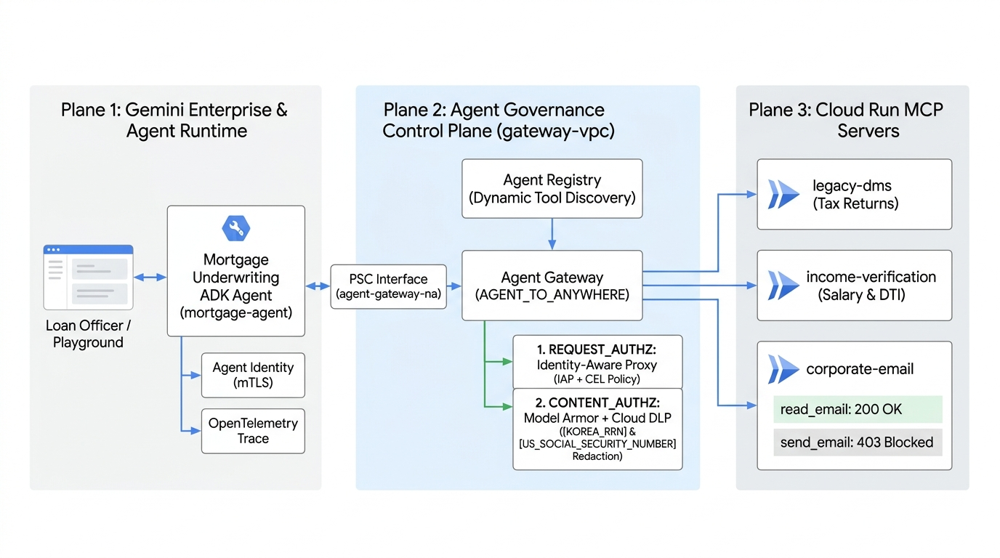
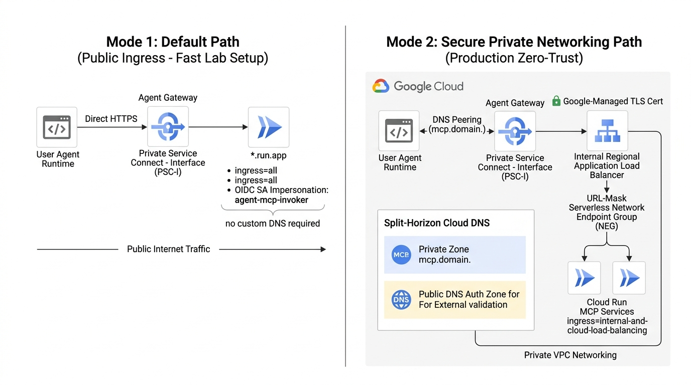
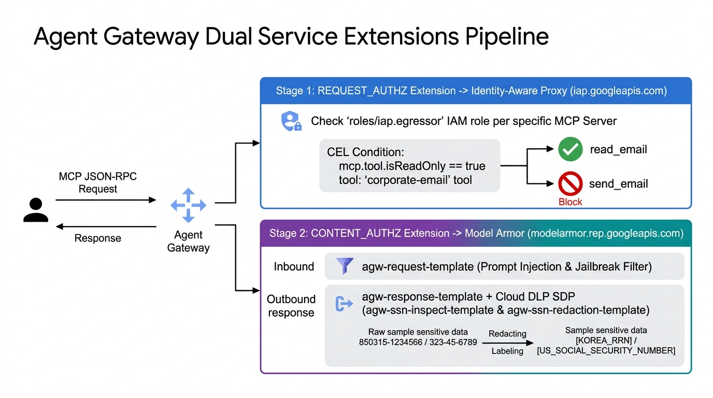
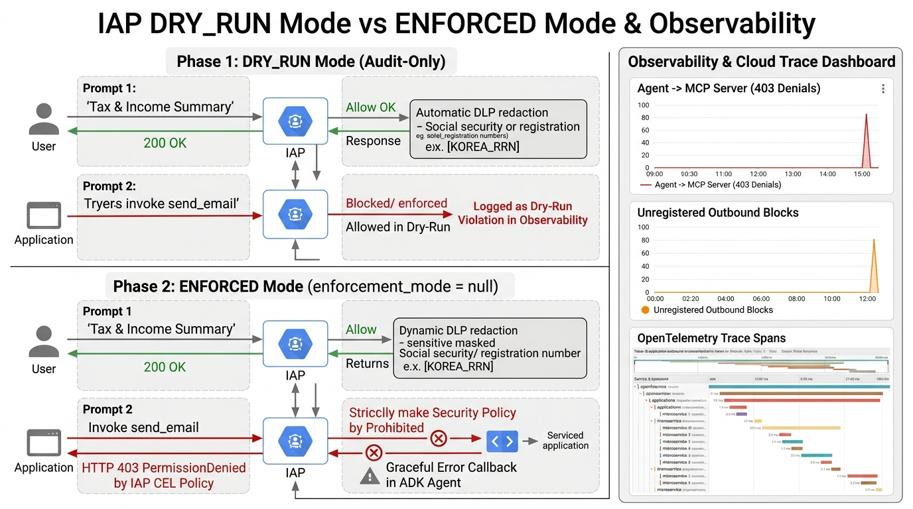
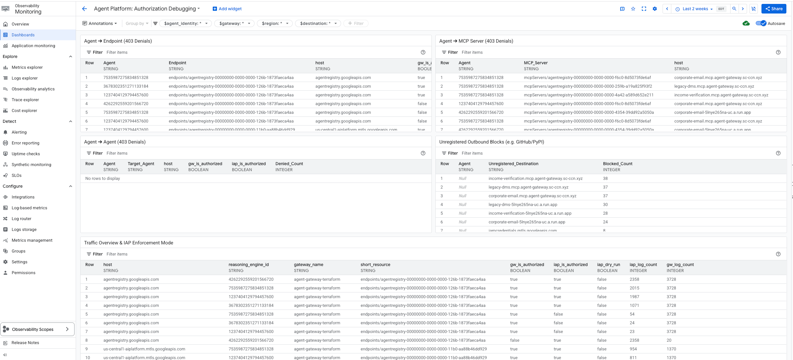

# Gemini Enterprise Agent Platform과 Agent Gateway(IAP·Model Armor)를 활용한 에이전트 워크로드 거버넌스

## 개요

엔터프라이즈 환경에서 자율형 AI 에이전트가 실제 비즈니스 가치를 창출하려면 내부 문서 관리 시스템, 외부 금융 검증 API, 사내 이메일 서버 등 다양한 엔터프라이즈 시스템과 연결되어야 합니다. **Model Context Protocol (MCP)** 은 에이전트가 이러한 외부 도구(Tool)를 표준화된 JSON-RPC 인터페이스로 호출할 수 있게 해주지만, 동시에 기업 보안팀과 플랫폼 엔지니어에게 다음과 같은 세 가지 핵심 거버넌스 과제를 안겨줍니다.

1. **세분화된 도구(Tool) 단위 접근 제어 부재**: 특정 MCP 서버에 대한 네트워크 연결 및 호출 권한(`roles/run.invoker`)을 부여하면, 에이전트가 해당 서버의 안전한 조회 도구(`search_emails`, `read_email`)뿐만 아니라 외부로 민감 정보를 유출하거나 상태를 변경하는 고위험 도구(`send_email`)까지 무제한으로 호출할 수 있습니다.
2. **민감 개인정보(PII)의 LLM 컨텍스트 유입 위험**: 레거시 DB나 문서 시스템이 반환하는 원본 응답에 **한국 주민등록번호(`KOREA_RRN`)** 나 **미국 사회보장번호(`US_SOCIAL_SECURITY_NUMBER`)** 같은 고위험 개인정보가 포함되어 있으면, 해당 데이터가 그대로 LLM 프롬프트 컨텍스트와 대화 로그에 노출됩니다.
3. **에이전트-도구 간 블랙박스 통신 및 관측성(Observability) 부족**: 에이전트가 어떤 MCP 도구를 얼마나 호출하는지, 지연 시간(Latency)이 어디서 발생하는지, 어떤 보안 정책에 의해 차단 또는 마스킹되었는지 중앙에서 추적하기 어렵습니다.

이 실습에서는 **에이펙스 금융그룹(Apex Financial Group)의 주택담보대출 자동 심사 에이전트(`mortgage-agent`)** 시나리오를 바탕으로, 백엔드 MCP 서버의 비즈니스 로직을 수정하지 않고도 **Google Cloud Agent Gateway**와 **Service Extensions(IAP 및 Model Armor + Cloud DLP)** 를 결합하여 중앙 집중식 보안 거버넌스와 통합 관측성을 구현합니다.



---

### 실습 시나리오: 에이펙스 금융그룹 주택담보대출 심사 에이전트

에이펙스 금융그룹의 대출 심사관(Underwriter)은 공동 신청자인 **김민준(Minjun Kim) · 이서연(Seoyeon Lee)** 부부의 2026년 신규 주택담보대출 적격 여부를 심사하기 위해 Vertex AI Agent Engine에서 실행되는 **`mortgage-agent`** 를 사용합니다. 에이전트는 심사를 수행하기 위해 다음 3개의 백엔드 MCP 서버와 통신합니다.

| MCP 서버 이름 | 비즈니스 역할 | 노출된 MCP 도구 (Tools) | Agent Gateway 배포 토폴로지 | 적용되는 거버넌스 정책 |
| :--- | :--- | :--- | :--- | :--- |
| **`legacy-dms`** | 레거시 문서 관리 시스템 (2023·2024 소득금액증명원 조회) | `search_tax_returns`, `get_document_metadata` | **클라이언트 사이드 (`agent-egress`)**<br>`AGENT_TO_ANYWHERE` | **Model Armor + Cloud DLP (`CONTENT_AUTHZ`)**:<br>응답 내 주민등록번호(`850315-1234566` ➔ `[KOREA_RRN]`) 및 SSN(`323-45-6789` ➔ `[US_SOCIAL_SECURITY_NUMBER]`) 자동 마스킹 |
| **`income-verification`** | 외부 소득 및 재직 검증 API (2026년 DTI 산출) | `verify_income` | **클라이언트 사이드 (`agent-egress`)**<br>`AGENT_TO_ANYWHERE` | **Model Armor + Cloud DLP (`CONTENT_AUTHZ`)**:<br>외부 API 요청·응답 내 주민등록번호(`[KOREA_RRN]`) 및 SSN(`[US_SOCIAL_SECURITY_NUMBER]`) 양방향 마스킹 |
| **`corporate-email`** | 사내 이메일 및 심사 지침 서버 (2026년 DTI 한도 45% 공지) | `search_emails`, `read_email`, `send_email` | **서버 사이드 (`cloud-run`)**<br>`self_managed` 인그레스 보호 | **IAP + CEL (`REQUEST_AUTHZ`)**:<br>`search_emails`·`read_email` 조회는 허용하되, `send_email` 도구 호출은 차단 (`DRY_RUN` 검증 후 `ENFORCED` 전환) |

---

### 핵심 아키텍처 개념

#### 1. Agent Gateway의 두 가지 배포 토폴로지: 클라이언트 사이드(`agent-egress`) vs 서버 사이드(`cloud-run`)
* **클라이언트 사이드 게이트웨이 (`google_managed.governed_access_path = "AGENT_TO_ANYWHERE"`)**: 에이전트의 아웃바운드(Egress) 경로에 위치하는 정방향 프록시(Forward Proxy)입니다. 타사 SaaS API나 직접 제어할 수 없는 레거시 시스템(`legacy-dms`, `income-verification`)으로 나가는 에이전트 트래픽을 가로채어 감사 및 DLP 마스킹을 수행합니다.
* **서버 사이드 게이트웨이 (`self_managed.resource_uri`)**: 기업 내부의 Cloud Run MCP 워크로드(`corporate-email`) 앞단에 위치하는 역방향 프록시(Reverse Proxy)입니다. 모든 인바운드 MCP 요청에 대해 호출자 ID 검증과 도구 단위 인가(IAP CEL)를 강제합니다.



#### 2. Service Extensions 기반 이중 보안 통제: IAP(`REQUEST_AUTHZ`) & Model Armor(`CONTENT_AUTHZ`)
Agent Gateway는 Envoy 기반 데이터 플레인 위에서 두 가지 실행 단계(Phase)로 Google Cloud 보안 서비스를 체이닝합니다.
* **`REQUEST_AUTHZ` 단계 — Identity-Aware Proxy (IAP) + CEL**: MCP JSON-RPC 요청 헤더와 본문(`request.mcp.method`, `request.mcp.tool.name`)을 분석하여 특정 도구 호출을 허용하거나 거부합니다. 또한 **`DRY_RUN` 모드**를 지원하므로 운영 트래픽을 중단시키지 않고 정책 위반 여부를 먼저 감사 로그로 검증한 뒤 **강제 적용(`ENFORCED`) 모드**로 안전하게 전환할 수 있습니다.
* **`CONTENT_AUTHZ` 단계 — Model Armor + Cloud DLP (Sensitive Data Protection)**: MCP 요청 및 응답 페이로드(`structuredContent`)를 실시간 스캔하여 프롬프트 인젝션 공격을 차단하고, 한국 주민등록번호(`KOREA_RRN`)와 미국 사회보장번호(`US_SOCIAL_SECURITY_NUMBER`)를 `[KOREA_RRN]`, `[US_SOCIAL_SECURITY_NUMBER]` 토큰으로 치환(Redaction)합니다.



---

### 학습 목표

이 실습을 완료하면 다음 작업을 수행할 수 있습니다.

* Skaffold와 Cloud Build를 사용하여 3종의 FastMCP 기반 백엔드 서버(`legacy-dms`, `income-verification`, `corporate-email`) 컨테이너를 빌드하고 Artifact Registry에 배포합니다.
* Terraform을 사용하여 클라이언트 사이드(`agent-egress`) 및 서버 사이드(`cloud-run`) Agent Gateway 3종과 Cloud Monitoring 커스텀 대시보드를 프로비저닝합니다.
* Cloud DLP `InspectTemplate` / `DeidentifyTemplate`(`KOREA_RRN`, `US_SOCIAL_SECURITY_NUMBER`)과 Model Armor 템플릿을 구성하여 MCP 응답 내 민감 개인정보를 실시간 마스킹합니다.
* IAP의 CEL(Common Expression Language) 정책을 `DRY_RUN` 모드로 먼저 배포하여 테스트한 뒤, `ENFORCED` 모드로 전환하여 무단 외부 이메일 발송(`send_email`)을 실시간 차단합니다.
* Vertex AI Agent Engine Playground, Cloud Monitoring 대시보드, Cloud Trace, Cloud Logging을 활용해 에이전트 거버넌스 동작을 엔드투엔드로 검증합니다.

---

## 설정 및 요구사항

### 실습 시작 전 확인사항

1. Qwiklabs 화면 좌측 상단의 **Start Lab(실습 시작)** 버튼을 클릭합니다.
2. 실습 환경이 준비되면 좌측 패널에 표시되는 **Project ID**, **Region**, **Username**, **Password** 정보를 확인합니다.
3. **Open Google Cloud console** 버튼을 클릭하여 시크릿 창(Incognito)에서 Google Cloud 콘솔에 로그인합니다.
4. 콘솔 우측 상단의 터미널 아이콘(**Activate Cloud Shell**)을 클릭하여 Cloud Shell을 엽니다.

> **참고**: Qwiklabs 시작 스크립트(Startup Script)가 실습에 필요한 Google Cloud API 20종과 기본 서비스 에이전트(Vertex AI, Cloud DLP)를 백그라운드에서 사전 활성화합니다.

---

## 작업 1. 실습 환경 변수 설정 및 소스 저장소 클론

Cloud Shell에서 프로젝트 환경 변수를 설정하고, 한국형 주택담보대출 심사 시나리오가 적용된 실습 저장소를 클론합니다.

### 1. 환경 변수 초기화 및 인증 확인

Cloud Shell 터미널에서 다음 명령어를 실행합니다.

```bash
export PROJECT_ID=$(gcloud config get-value project)
export PROJECT_NUMBER=$(gcloud projects describe "${PROJECT_ID}" --format="value(projectNumber)")
export ORG_ID=$(gcloud projects get-ancestors "${PROJECT_ID}" --format='value(id)' | tail -n 1)
if [ "${ORG_ID}" = "${PROJECT_ID}" ] || [ "${ORG_ID}" = "${PROJECT_NUMBER}" ]; then
  export ORG_ID=""
fi
export REGION="us-central1"

gcloud config set project "${PROJECT_ID}"
gcloud config set compute/region "${REGION}"

echo "PROJECT_ID     : ${PROJECT_ID}"
echo "PROJECT_NUMBER : ${PROJECT_NUMBER}"
echo "ORG_ID         : ${ORG_ID:-'(No Organization - Project Fallback Mode)'}"
echo "REGION         : ${REGION}"
```

### 2. 실습 소스 코드 저장소 클론

다음 명령어를 실행하여 실습 저장소를 클론하고 디렉터리 구조를 확인합니다.

```bash
cd ~
rm -rf ~/agent-gateway-governance
git clone https://github.com/wxdxh/agent-gateway-governance.git ~/agent-gateway-governance 2>/dev/null || \
  git clone -b governance https://github.com/wxdxh/agent-gateway-sgp.git ~/agent-gateway-governance

cd ~/agent-gateway-governance
ls -la
```

저장소는 다음과 같은 핵심 디렉터리로 구성되어 있습니다.

* `src/legacy-dms/`: 소득금액증명원 검색 및 문서 메타데이터를 제공하는 FastMCP 서버 (주민등록번호 `850315-1234566` 및 SSN 포함)
* `src/income-verification-api/`: 신청자 소득 검증 및 2026년 DTI 비율을 계산하는 FastMCP 서버
* `src/corporate-email/`: 사내 언더라이팅 지침 이메일 검색·열람(`search_emails`, `read_email`) 및 이메일 발송(`send_email`) 도구를 가진 FastMCP 서버
* `src/mortgage-agent/`: Google ADK 기반 주택담보대출 심사 에이전트 및 배포 스크립트(`deploy_agent.py`)
* `terraform/`: Cloud Run, Agent Gateway, IAP, Model Armor/DLP, Vertex AI Agent Engine, Cloud Monitoring 대시보드를 배포하는 Terraform 모듈
* `scripts/grant_agent_mcp_egress.sh`: 배포된 에이전트 ID에 Agent Gateway 호출 권한(`roles/networkservices.agentGatewayUser`) 및 Cloud Run 호출 권한(`roles/run.invoker`)을 부여하는 스크립트

---

## 작업 2. 3종 백엔드 MCP 서버 코드 점검 및 컨테이너 이미지 빌드

Agent Gateway의 Model Armor(`CONTENT_AUTHZ`)가 MCP 도구 응답에서 민감 정보를 정확히 마스킹하려면, MCP 서버가 데이터를 반환하는 방식을 이해해야 합니다.

### 1. FastMCP의 `structuredContent` 반환 구조 확인

다음 명령어로 `src/legacy-dms/server.py`의 도구 반환 코드를 확인합니다.

```bash
sed -n '95,145p' ~/agent-gateway-governance/src/legacy-dms/server.py
```

* FastMCP는 기본적으로 파이썬 딕셔너리 반환값을 직렬화할 때 일반 텍스트 블록(`content`)과 구조화된 JSON 블록(`structuredContent`)을 동시에 생성합니다.
* 현재 **Agent Gateway의 Model Armor 연동은 MCP 응답의 `structuredContent` 필드만 검사하고 마스킹(Redaction)** 합니다. 만약 `content` 배열에 원본 문자열이 남아 있으면 마스킹되지 않은 주민등록번호나 SSN이 에이전트로 유출될 수 있으므로, 모든 MCP 도구는 반드시 `ToolResult(content=[], structured_content=...)` 형태로 반환하도록 설계되어 있습니다.

### 2. Artifact Registry 저장소 생성

컨테이너 이미지를 저장할 Artifact Registry 저장소(`mcp-servers`)를 Terraform으로 먼저 생성합니다.

```bash
cd ~/agent-gateway-governance/terraform
terraform init

terraform apply \
  -target=google_project_service.apis \
  -target=google_artifact_registry_repository.mcp_servers \
  -var="project_id=${PROJECT_ID}" \
  -var="region=${REGION}" \
  -auto-approve
```

### 3. Skaffold를 이용한 3종 MCP 서버 이미지 빌드 및 푸시

루트 디렉터리로 이동한 뒤 `skaffold build` 명령어로 `legacy-dms`, `income-verification`, `corporate-email` 3개 컨테이너 이미지를 빌드하여 Artifact Registry에 푸시합니다.

```bash
cd ~/agent-gateway-governance
export REPO="${REGION}-docker.pkg.dev/${PROJECT_ID}/mcp-servers"

skaffold build --default-repo="${REPO}"
```

빌드가 완료되면 Artifact Registry에 3개의 이미지가 정상 등록되었는지 확인합니다.

```bash
gcloud artifacts docker images list "${REPO}" --include-tags
```

<ql-activity-tracking step=1>
Artifact Registry 및 MCP 서버 컨테이너 빌드 확인하기
</ql-activity-tracking>

---

## 작업 3. Agent Gateway 3종 및 IAP · Model Armor(KOREA_RRN/SSN) Terraform 배포

이제 Terraform을 사용하여 Cloud Run MCP 서버 3종, Agent Gateway 3종, IAP(`DRY_RUN` 모드), Model Armor 및 Cloud DLP 템플릿, Vertex AI Agent Engine 셸, 그리고 관측성 대시보드를 한 번에 프로비저닝합니다.

### 1. Terraform 거버넌스 구성 파일 점검

배포 전에 `terraform/main.tf`와 `terraform/variables.tf`에서 각 보안 계층이 어떻게 정의되어 있는지 확인합니다.

```bash
cat ~/agent-gateway-governance/terraform/variables.tf
```

주요 구성 포인트는 다음과 같습니다.

1. **`model_armor_pii_types`**: 기본값으로 `["US_SOCIAL_SECURITY_NUMBER", "KOREA_RRN"]`이 설정되어 있어, Cloud DLP가 미국 사회보장번호(`323-45-6789`)와 한국 주민등록번호(`850315-1234566`, `870822-2345673`)를 모두 탐지하고 각각 `[US_SOCIAL_SECURITY_NUMBER]`, `[KOREA_RRN]`으로 마스킹합니다.
2. **`enforcement_mode = "DRY_RUN"`**: `corporate-email` 서버 앞단의 IAP CEL 정책(`request.mcp.tool.name != "send_email"`)이 초기에는 `DRY_RUN` 모드로 배포됩니다. 즉, 첫 테스트에서는 `send_email` 호출이 실제로 차단되지 않고 감사 로그에만 기록됩니다.
3. **`enable_private_networking`**: 기본값은 `false`(퍼블릭 `*.run.app` 인그레스 + IAM 인증)로 설정되어 있어 빠른 실습이 가능하며, 엔터프라이즈 폐쇄망 환경에서는 `true`로 설정하여 커스텀 VPC, Proxy-Only 서브넷, Network Attachment, 프라이빗 Cloud DNS 구성을 활성화할 수 있습니다.

### 2. `terraform.tfvars` 생성 및 전체 인프라 프로비저닝

다음 명령어로 `terraform.tfvars` 파일을 생성하고 `terraform apply`를 실행합니다.

```bash
cd ~/agent-gateway-governance/terraform

cat <<EOF > terraform.tfvars
project_id                = "${PROJECT_ID}"
region                    = "${REGION}"
enable_private_networking = false
enforcement_mode          = "DRY_RUN"
EOF

terraform apply -auto-approve
```

> **참고**: Cloud DLP 템플릿, Model Armor 템플릿, 3개의 Cloud Run 서비스, 3개의 Agent Gateway 및 IAP 바인딩이 생성되는 데 약 2~3분이 소요됩니다.

### 3. Terraform 출력값(Outputs) 확인

프로비저닝이 완료되면 생성된 Agent Gateway 엔드포인트 URL과 Agent Engine 리소스 이름을 확인합니다.

```bash
terraform output
```

출력 예시:

```text
agent_engine_resource_name = "projects/123456789012/locations/us-central1/reasoningEngines/9876543210987654321"
agent_gateway_endpoints = {
  "corporate-email" = "https://agw-corporate-email-xxxxx.us-central1.agentgateway.cloud.goog/mcp"
  "income-verification" = "https://agw-income-verification-xxxxx.us-central1.agentgateway.cloud.goog/mcp"
  "legacy-dms" = "https://agw-legacy-dms-xxxxx.us-central1.agentgateway.cloud.goog/mcp"
}
```

<ql-activity-tracking step=2>
Agent Gateway 3종 및 IAP · Model Armor 구성 확인하기
</ql-activity-tracking>

---

## 작업 4. 주택담보대출 심사 에이전트(`mortgage-agent`) 배포 및 Egress IAM 권한 설정

Terraform은 에이전트의 고유 ID(Agent Identity)를 선발급하기 위해 빈 Vertex AI Agent Engine(Reasoning Engine) 셸을 먼저 생성했습니다. 이제 ADK로 작성된 실제 `mortgage-agent` 파이썬 코드를 해당 Agent Engine에 업로드하고, 에이전트가 Agent Gateway를 통과해 MCP 서버를 호출할 수 있도록 최소 권한 IAM을 부여합니다.

### 1. ADK 에이전트의 Agent Gateway 인증 코드 확인

`src/mortgage-agent/agent/agent.py`에서 에이전트가 3개의 Agent Gateway 엔드포인트에 연결하는 방식을 확인합니다.

```bash
sed -n '90,155p' ~/agent-gateway-governance/src/mortgage-agent/agent/agent.py
```

* 에이전트는 백엔드 Cloud Run URL을 직접 호출하지 않고, 환경 변수(`AGENT_GATEWAY_ENDPOINTS`)로 주입된 3개의 **Agent Gateway URL(`*.agentgateway.cloud.goog/mcp`)** 로만 통신합니다.
* `GoogleCredentialsAuth` 클래스가 런타임에 에이전트 고유 ID(Agent Identity)의 OAuth2 액세스 토큰과 Google ID 토큰을 자동으로 발급받아 HTTP `Authorization: Bearer ...` 헤더에 주입합니다.

### 2. Vertex AI Agent Engine에 `mortgage-agent` 코드 배포

`uv` 패키지 매니저를 사용하여 `deploy_agent.py` 스크립트를 실행합니다. 이 스크립트는 Terraform 출력값을 자동으로 읽어 기존 Agent Engine 리소스를 최신 에이전트 코드와 시스템 프롬프트로 업데이트합니다.

```bash
cd ~/agent-gateway-governance/src/mortgage-agent
uv run deploy_agent.py
```

배포가 완료되면 마지막 줄에 `Update completed: projects/.../locations/us-central1/reasoningEngines/...` 메시지가 출력됩니다.

### 3. 에이전트 Egress IAM 권한 부여 (`grant_agent_mcp_egress.sh`)

에이전트가 Agent Gateway 데이터 플레인을 통과하고 서버 사이드 Cloud Run(`corporate-email`)을 호출하려면 두 가지 IAM 역할이 필요합니다.

1. **`roles/networkservices.agentGatewayUser`**: 에이전트가 프로젝트 내 Agent Gateway를 통과할 수 있는 권한
2. **`roles/run.invoker`**: 서버 사이드 토폴로지(`corporate-email`)에서 Agent Gateway가 검증된 에이전트 ID를 대신해 Cloud Run 서비스를 호출할 수 있는 권한

다음 스크립트를 실행하여 에이전트 ID에 권한을 부여합니다.

```bash
cd ~/agent-gateway-governance
chmod +x ./scripts/grant_agent_mcp_egress.sh
./scripts/grant_agent_mcp_egress.sh
```

> **참고**: IAM 정책 변경 사항이 Google Cloud 전역에 전파되는 데 약 60초가 소요될 수 있습니다.

<ql-activity-tracking step=3>
Vertex AI Agent Engine 배포 및 Egress IAM 권한 설정 확인하기
</ql-activity-tracking>

---

## 작업 5. 1단계 검증: IAP `DRY_RUN` 모드 및 Model Armor PII 마스킹 테스트

이제 Google Cloud 콘솔의 **Agent Engine Playground**에서 에이펙스 금융그룹의 주택담보대출 심사 시나리오를 실행하여 두 가지를 동시에 검증합니다.

1. **Model Armor + Cloud DLP (`CONTENT_AUTHZ`)**: `legacy-dms`와 `income-verification`이 반환한 김민준·이서연 부부의 주민등록번호(`850315-1234566`, `870822-2345673`)와 SSN(`323-45-6789`, `321-54-9876`)이 `[KOREA_RRN]` 및 `[US_SOCIAL_SECURITY_NUMBER]`로 마스킹되는지 확인합니다.
2. **IAP (`REQUEST_AUTHZ` - `DRY_RUN` 모드)**: `corporate-email`의 `send_email` 도구가 현재 `DRY_RUN` 상태이므로 차단되지 않고 실행되는지 확인합니다.



### 1. Vertex AI Agent Engine Playground 열기

1. Google Cloud 콘솔 상단 검색창에 **Agent Engine**을 입력하고 **Vertex AI > Agent Engine**으로 이동합니다.
2. 리전이 **`us-central1`** 로 선택되어 있는지 확인한 후, 배포된 **`mortgage_agent`** 를 클릭합니다.
3. 상단 탭에서 **Playground**를 클릭합니다.

### 2. 주택담보대출 심사 및 이메일 발송 프롬프트 실행

Playground 채팅창에 다음 프롬프트(한국어 또는 영문)를 입력하고 실행합니다.

```text
김민준(Minjun Kim)과 이서연(Seoyeon Lee) 부부가 2026년 신규 주택담보대출 적격 요건을 충족하는지 심사해 주세요.
1) legacy-dms에서 김민준 가족의 세금 신고서(소득금액증명원)와 문서 메타데이터를 조회해 주민등록번호(RRN)와 SSN, 소득을 확인하고,
2) income-verification으로 두 사람의 소득 및 2026년 DTI 비율을 검증한 뒤,
3) corporate-email에서 최신 2026년 언더라이팅 DTI 한도 지침 이메일을 찾아 읽고,
4) 심사 요약 결과를 underwriting-team@apex-financial.kr 로 이메일 발송(send_email)해 주세요.
```

### 3. 에이전트 응답 결과 확인

에이전트가 3개 MCP 서버의 도구를 차례대로 호출한 뒤 다음과 같은 결과를 반환하는지 확인합니다.

* **개인정보 마스킹 확인 (Model Armor + Cloud DLP 작동)**:
  * 원본 데이터에 저장된 김민준의 주민등록번호 `850315-1234566`과 이서연의 주민등록번호 `870822-2345673`이 **`[KOREA_RRN]`** 으로 마스킹되어 표시됩니다.
  * 미국 SSN `323-45-6789`, `321-54-9876` 역시 **`[US_SOCIAL_SECURITY_NUMBER]`** 로 마스킹되어 LLM 컨텍스트와 화면 어디에도 원본 번호가 노출되지 않습니다.
* **2026년 DTI 심사 및 이메일 발송 확인 (IAP `DRY_RUN` 모드)**:
  * 사내 이메일(`msg-002`)에 명시된 2026년 신규 주택담보대출 최대 DTI 한도(**45.0%**) 대비 김민준·이서연 부부의 추정 합산 DTI(**28.4%**, 합산 연소득 $237,000)가 기준 이하이므로 **적격(Eligible)** 판정이 내려집니다.
  * 현재 IAP 정책이 `DRY_RUN` 모드이므로 `send_email` 도구 호출이 차단되지 않고 성공(`status: sent`)합니다.

---

## 작업 6. 통합 관측성(Observability) 대시보드 및 Cloud Trace · Logging 분석

Agent Gateway는 통과하는 모든 MCP 트래픽에 대해 표준 메트릭, 분산 트레이스(Cloud Trace), 보안 감사 로그(Cloud Logging)를 자동으로 생성합니다.

### 1. Cloud Monitoring 거버넌스 대시보드 확인

1. Google Cloud 콘솔에서 **Monitoring > Dashboards(대시보드)** 로 이동합니다.
2. Terraform이 생성한 **`Agent Gateway Governance Overview`** 대시보드를 클릭합니다.



대시보드에서 다음 4가지 핵심 지표를 확인할 수 있습니다.

* **MCP Request Rate by Tool**: `search_tax_returns`, `get_document_metadata`, `verify_income`, `search_emails`, `read_email`, `send_email` 등 도구별 초당 호출 빈도
* **Agent Gateway Latency (p50 / p95)**: 게이트웨이 및 Service Extensions(IAP, Model Armor) 처리 지연 시간
* **Model Armor Verdict Breakdown**: `CONTENT_AUTHZ` 단계에서 PII 탐지·마스킹이 수행된 요청 비율
* **Active MCP Sessions**: 현재 활성화된 에이전트-게이트웨이 세션 수

### 2. Cloud Logging에서 Agent Gateway 및 Model Armor 로그 조회

Cloud Shell에서 다음 명령어를 실행하여 Agent Gateway를 통과한 MCP 요청 및 보안 확장 프로그램 로그를 조회합니다.

```bash
gcloud logging read \
  'resource.type="networkservices.googleapis.com/AgentGateway" OR protoPayload.serviceName="iap.googleapis.com" OR protoPayload.serviceName="modelarmor.googleapis.com"' \
  --project="${PROJECT_ID}" \
  --limit=10 \
  --format="table(timestamp, resource.type, httpRequest.status, jsonPayload.mcpMethod, jsonPayload.mcpToolName)"
```

---

## 작업 7. 2단계 검증: IAP `ENFORCED` 모드 전환 및 `send_email` 실시간 차단 확인

`DRY_RUN` 테스트와 관측성 대시보드를 통해 정상적인 조회 도구(`search_emails`, `read_email`)는 허용되고 `send_email`만 정책 위반으로 탐지되는 것을 확인했습니다. 이제 `agw-corporate-email` 게이트웨이의 IAP 정책을 **강제 적용(`ENFORCED`, `enforcement_mode = null`)** 으로 전환하여 에이전트의 무단 외부 이메일 발송을 실시간 차단합니다.

### 1. IAP CEL 정책 구조 확인

`terraform/main.tf`에 정의된 `agw-corporate-email`의 CEL 표현식을 확인합니다.

```hcl
expression = <<-EOT
  request.mcp.method in ["initialize", "notifications/initialized", "tools/list", "ResourceList", "PromptList"] ||
  (request.mcp.method == "tools/call" && request.mcp.tool.name != "send_email")
EOT
```

* MCP 세션 초기화(`initialize`) 및 도구 목록 조회(`tools/list`)는 허용합니다.
* 도구 실행(`tools/call`)의 경우 도구 이름이 `send_email`이 아닌 경우(`search_emails`, `read_email`)에만 통과시키고, `send_email` 호출은 즉시 `403 Permission Denied`로 거부합니다.

### 2. Terraform으로 `enforcement_mode = null` (Enforced 모드) 적용

Cloud Shell에서 `terraform.tfvars`의 `enforcement_mode`를 `null`로 변경하고 `terraform apply`를 실행합니다.

```bash
cd ~/agent-gateway-governance/terraform

cat <<EOF > terraform.tfvars
project_id                = "${PROJECT_ID}"
region                    = "${REGION}"
enable_private_networking = false
enforcement_mode          = null
EOF

terraform apply -auto-approve
```

> **참고**: IAP 설정 변경 사항이 Agent Gateway 데이터 플레인에 반영되는 데 약 60~90초가 소요됩니다.

### 3. Playground에서 `send_email` 실시간 차단 확인

60초 후 **Vertex AI > Agent Engine > `mortgage_agent` > Playground**로 돌아가서 새로운 세션을 열고 동일한 프롬프트를 다시 입력합니다.

```text
김민준(Minjun Kim)과 이서연(Seoyeon Lee) 부부의 2026년 주택담보대출 적격 여부를 다시 심사하고, 결과를 underwriting-team@apex-financial.kr 로 이메일 발송(send_email)해 주세요.
```

이번에는 다음과 같은 거버넌스 동작을 확인할 수 있습니다.

1. **조회 및 PII 마스킹 정상 수행**: `legacy-dms`(`search_tax_returns`), `income-verification`(`verify_income`), `corporate-email`(`search_emails`, `read_email`) 호출은 모두 정상 허용되며, 주민등록번호(`[KOREA_RRN]`)와 SSN(`[US_SOCIAL_SECURITY_NUMBER]`)은 계속 안전하게 마스킹됩니다.
2. **`send_email` 호출 즉시 차단**: 에이전트가 마지막 단계에서 `send_email` 도구를 호출하는 순간, **`agw-corporate-email` Agent Gateway의 IAP(`REQUEST_AUTHZ`)가 요청을 `403 Forbidden / Permission Denied`로 즉시 차단**합니다.
3. **에이전트의 우아한 폴백(Graceful Degradation)**: 에이전트는 심사 결과 보고서를 화면에는 정상 출력하되, *"보안 정책(접근 제어 제한)으로 인해 `send_email` 도구 호출이 거부되어 이메일을 발송할 수 없습니다"* 라고 안내합니다.

<ql-activity-tracking step=4>
IAP Enforced 모드 전환 및 send_email 차단 검증 확인하기
</ql-activity-tracking>

---

## 축하합니다!

에이펙스 금융그룹의 주택담보대출 심사 시나리오를 통해 **Agent Gateway**, **Identity-Aware Proxy(IAP CEL)**, **Model Armor + Cloud DLP(KOREA_RRN/SSN 마스킹)**, 그리고 **Cloud Monitoring/Trace 통합 관측성**을 결합한 엔터프라이즈 에이전트 거버넌스 아키텍처를 성공적으로 구축하고 검증했습니다!

### 핵심 요약

* **클라이언트 사이드(`agent-egress`) & 서버 사이드(`cloud-run`) 통합 제어**: 외부/레거시 API와 내부 Cloud Run MCP 서버 모두 코드 변경 없이 Agent Gateway로 보호했습니다.
* **데이터 유출 방지 (`CONTENT_AUTHZ`)**: Model Armor와 Cloud DLP를 연동하여 MCP `structuredContent` 응답에 포함된 한국 주민등록번호(`[KOREA_RRN]`)와 미국 SSN(`[US_SOCIAL_SECURITY_NUMBER]`)을 LLM 컨텍스트 유입 전에 자동 마스킹했습니다.
* **컨텍스트 인식 도구 인가 (`REQUEST_AUTHZ`)**: IAP의 CEL 표현식과 `DRY_RUN` ➔ `ENFORCED` 배포 라이프사이클을 활용해 안전한 읽기 도구(`search_emails`, `read_email`)는 허용하고 고위험 쓰기 도구(`send_email`)는 정밀 차단했습니다.
