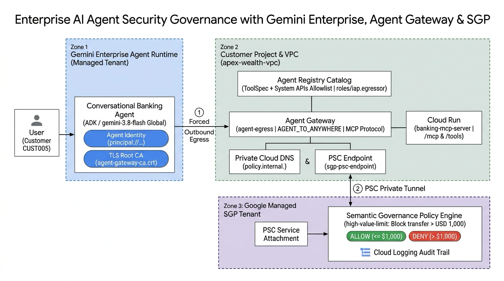
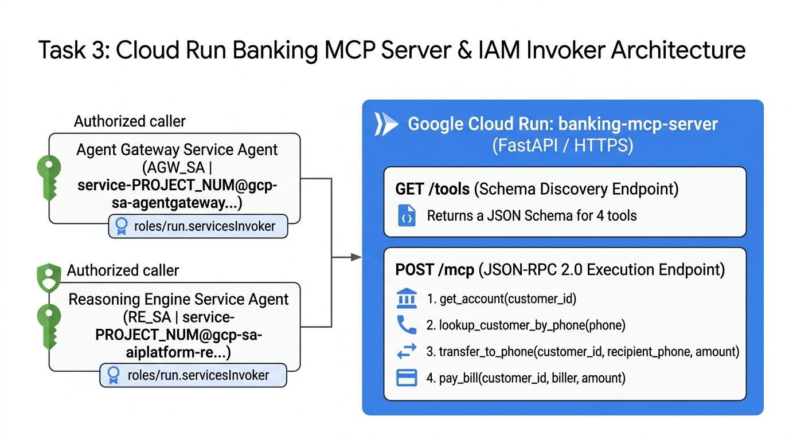
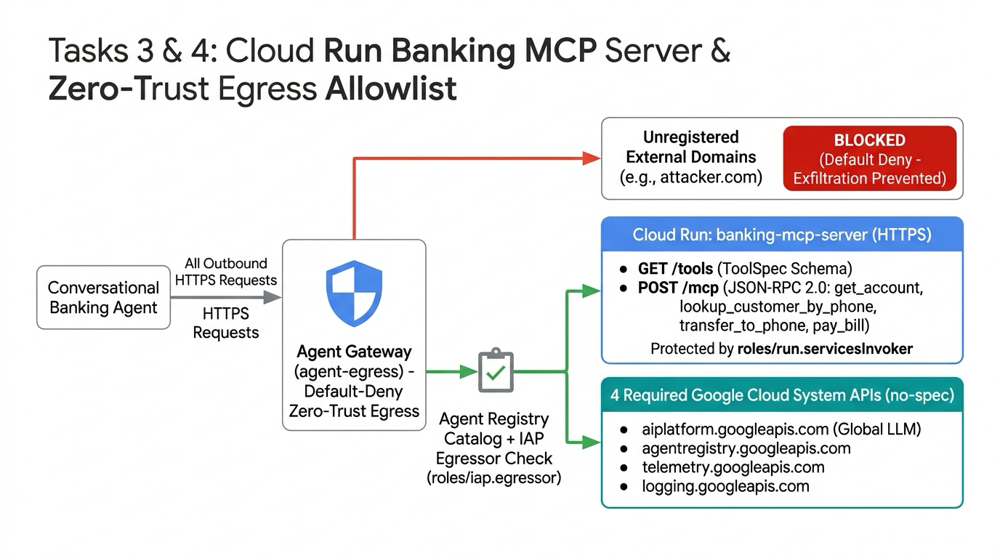
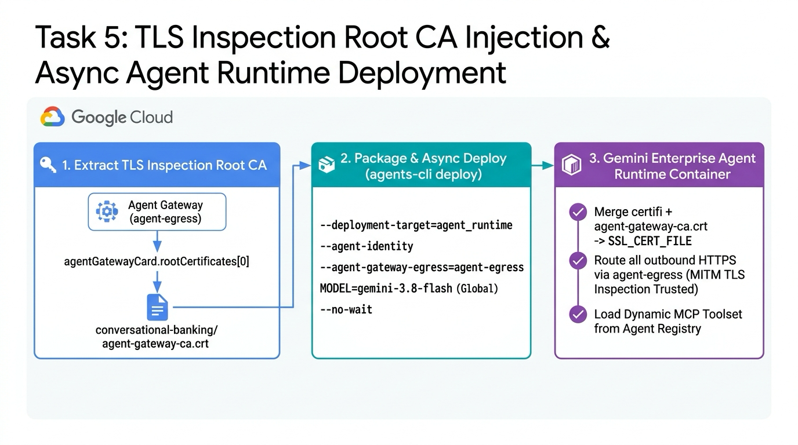
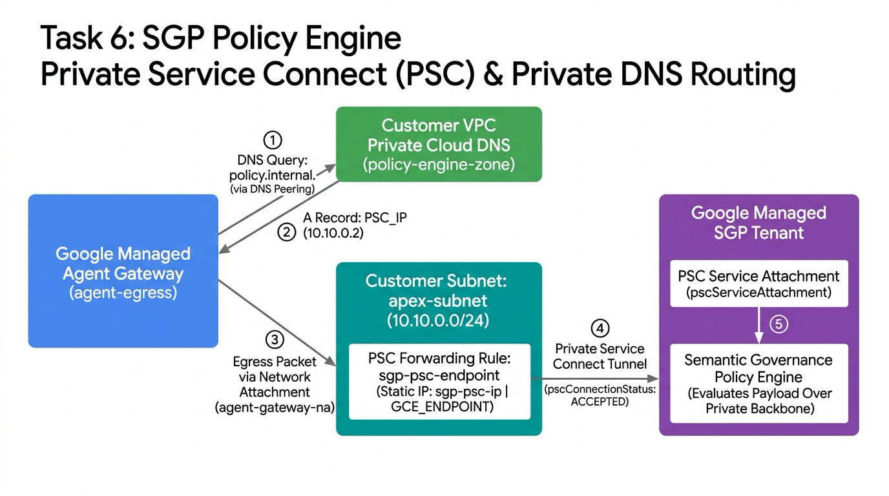
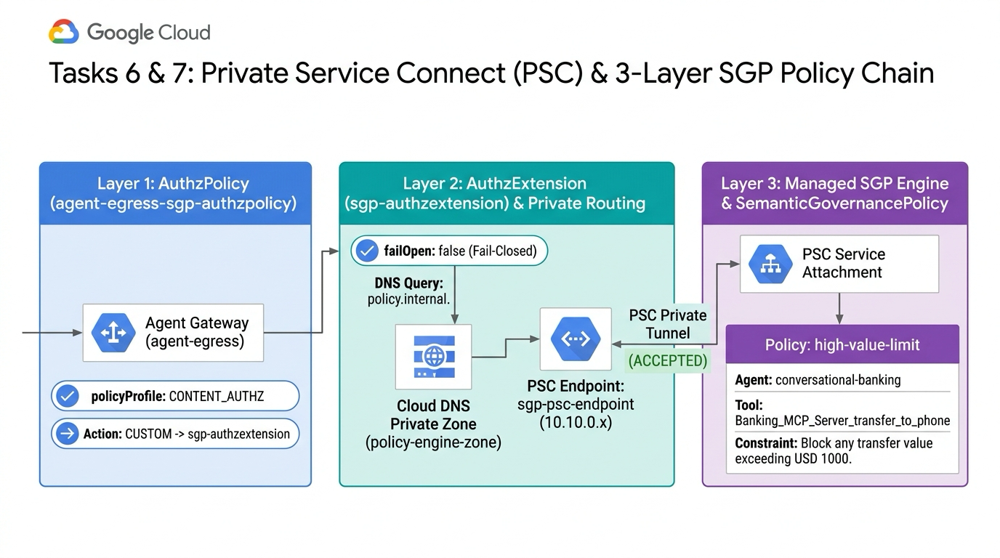
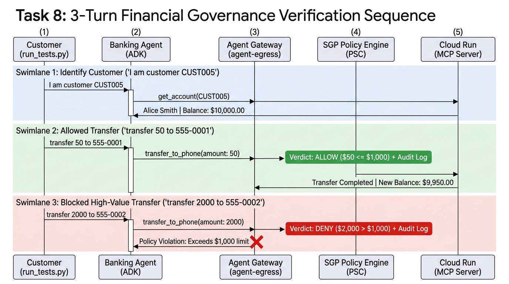

# Autonomous AI Agent Security Governance with Gemini Enterprise, Agent Gateway, and SGP

## Overview

Autonomous AI agents powered by Large Language Models (LLMs) can reason independently, orchestrate multi-step workflows, and directly invoke enterprise backend tools such as wire transfer APIs or core databases. However, granting an agent direct network access to backend systems introduces severe security and financial compliance risks from prompt injection, model hallucination, and unauthorized high-value transactions.

In this lab, based on the Apex Asset Management financial security scenario, you will build an enterprise governance architecture that enforces natural-language business rules in real time at the network boundary—without modifying agent application code. You will configure a conversational banking agent (`gemini-3.8-flash`, Global endpoint) running on Gemini Enterprise Agent Runtime to invoke a Cloud Run banking Model Context Protocol (MCP) server through Google Cloud Agent Gateway (`agent-egress`) and Semantic Governance Policies (SGP).

System prompts inside an agent alone cannot deterministically prevent bypass attacks or runtime misbehavior. By combining Agent Gateway and SGP, every outbound tool call is intercepted at the network boundary to enforce natural-language business policies—such as *"Block any transfer value exceeding USD 1000 (`amount <= 1000.0`)"*—without code changes, while recording full audit logs in Cloud Logging.

### Overall Architecture and Traffic Flow

The architecture diagram below illustrates the end-to-end interaction and traffic flow across the three architectural planes and tenant environments you will build in this lab (Plane 1: Gemini Enterprise Agent Runtime Tenant, Plane 2: Customer Project VPC & Control Plane, Plane 3: Google-Managed SGP Policy Evaluation Tenant).

| Stage | Component | Role and Traffic Flow |
| :--- | :--- | :--- |
| 1. User Request | Financial Customer (`CUST005`) → Gemini Enterprise Agent | Sends 3-turn conversational banking requests (`gemini-3.8-flash`, Global API) |
| 2. Call Interception | Gemini Enterprise Agent → Agent Gateway (`agent-egress`) | Intercepts outbound MCP tool calls at the network boundary and performs TLS inspection |
| 3. Catalog Validation | Agent Registry ↔ Agent Gateway | Verifies authorized MCP tool schemas and system API allowlist (`roles/iap.egressor`) |
| 4. Policy Evaluation (PSC) | Agent Gateway → SGP Policy Engine (`policy.internal.`) | Evaluates single-transfer limit (`USD 1000`) in real time over Private Service Connect (PSC) |
| 5. Execution & Auditing | Agent Gateway → Cloud Run (`banking-mcp-server`) | Forwards to Cloud Run MCP server on `ALLOW`, or blocks immediately and logs to Cloud Logging on `DENY` |

### Objectives

In this lab, you will use Google Cloud Shell to complete the following tasks and learn how to apply each component to your own enterprise environment:

1. Enable required Google Cloud APIs for Agent Gateway (`agent-egress`) and configure a 3-tier least-privilege identity separation model (`roles/agentgateway.serviceAgent`, `AGENT_IDENTITY`).
2. Provision a regional managed proxy-only subnet (`proxy-only-subnet`), a Network Attachment (`agent-gateway-na`), and an Agent Gateway in `AGENT_TO_ANYWHERE` mode.
3. Build and deploy the Apex Asset Management banking MCP server (`banking-mcp-server`) on Google Cloud Run, exposing four financial tools.
4. Register the banking MCP tool specification (`toolspec.json`) and four core system endpoints—including the Gemini Enterprise Global API (`https://aiplatform.googleapis.com`)—in Agent Registry, and bind IAP Egress (`roles/iap.egressor`) permissions.
5. Asynchronously deploy (`--no-wait`) the Google ADK conversational banking agent (`gemini-3.8-flash`, `GOOGLE_CLOUD_LOCATION=global`) to Gemini Enterprise Agent Runtime.
6. While the agent builds in the background, enable the SGP Policy Engine and configure a Private Service Connect (PSC) endpoint (`sgp-psc-endpoint`) and private Cloud DNS zone (`policy.internal.`).
7. Create a Service Extension (`AuthzExtension`), a Network Security Authorization Policy (`AuthzPolicy`), and a natural-language Semantic Governance Policy (`high-value-limit`) that blocks transfers exceeding USD 1,000.
8. Run a 3-turn financial transaction scenario in Cloud Shell (customer verification, allowed $50 transfer `ALLOW`, blocked $2,000 transfer `DENY`) and inspect SGP audit logs in Cloud Logging.

### Prerequisites

* Basic familiarity with the Google Cloud Console and Cloud Shell
* Foundational knowledge of Google Cloud networking (VPC subnets, Private Service Connect, Cloud DNS)
* Basic understanding of Python-based AI agents (ADK) and the Model Context Protocol (MCP)

## Setup and Requirements

### Start the Lab and Sign In to the Google Cloud Console

1. Click the **Start Lab** button at the top left of the page. When the lab starts, a temporary Google Cloud project and login credentials (Username and Password) are provisioned.
2. To prevent account conflicts and unintended charges, always run the lab in an **Incognito Window**.
3. Right-click **Open Google Cloud console** in the left panel to open it in an Incognito window, then sign in using the provided Username and Password.
4. Accept the terms and conditions if prompted. Do not add recovery options or two-factor authentication because this is a temporary account.

<ql-warningbox><strong>Warning:</strong> Do not click <strong>End Lab</strong> at the top left until you have completely finished the lab. Clicking <strong>End Lab</strong> immediately deletes your active work and the temporary Google Cloud project.</ql-warningbox>

### Activate Cloud Shell

In the top-right toolbar of the Google Cloud Console, click the **Activate Cloud Shell** icon to open the Cloud Shell terminal. If prompted, click **Continue** and **Authorize**.

### Prepare the Lab Repository and CLI Tools

When the lab starts, the startup provisioning script (`terraform/main.tf`) automatically runs in the background to prepare the required Google Cloud APIs, dedicated VPC network (`apex-wealth-vpc`), regional subnet (`apex-subnet`, `10.10.0.0/24`), regional managed proxy-only subnet (`proxy-only-subnet`, `10.11.13.0/24`), private Cloud DNS zone (`policy-engine-zone`), internal PSC IP address (`sgp-psc-ip`), and baseline service agent IAM bindings.

Once the Cloud Shell terminal opens, run the following commands in order to prepare your environment:

1. Verify the active account and configured Project ID:

<ql-code-block language="bash">
gcloud auth list
gcloud config list project
</ql-code-block>

2. If the Project ID is not set, configure it using the Project ID shown in the left panel:

<ql-code-block language="bash" templated>
gcloud config set project {{{project_0.project_id|PROJECT_ID}}}
</ql-code-block>

3. Clone the lab repository into your Cloud Shell home directory (`$HOME`) and change into the project directory:

<ql-code-block language="bash">
cd ~
git clone https://github.com/wxdxh/agent-gateway-sgp.git
cd ~/agent-gateway-sgp
chmod +x *.sh
</ql-code-block>

4. Install `uv` and `google-agents-cli`, which are used to package and deploy agents to Gemini Enterprise Agent Runtime:

<ql-code-block language="bash">
curl -LsSf https://astral.sh/uv/install.sh | sh
export PATH="$HOME/.local/bin:$PATH"
echo 'export PATH="$HOME/.local/bin:$PATH"' >> ~/.bashrc

uv tool install google-agents-cli
agents-cli --version
</ql-code-block>

5. Source the shared environment script (`env.sh`) and verify that your project metadata, VPC (`apex-wealth-vpc`), and subnet (`apex-subnet`) are detected:

<ql-code-block language="bash">
cd ~/agent-gateway-sgp
source env.sh
</ql-code-block>

When loaded properly, the script prints the following environment details:

<ql-code-block output>
Project ID:     qwiklabs-gcp-xx-xxxxxxxxxxxx
Project Number: 1080321871308
Location:       us-central1
VPC Network:    apex-wealth-vpc
VPC Subnet:     apex-subnet
Agent GW SA:    serviceAccount:service-1080321871308@gcp-sa-agentgateway.iam.gserviceaccount.com
</ql-code-block>

#### Detailed Breakdown of `env.sh`

Running `source env.sh` exports shared environment variables into your current shell session for all subsequent scripts (`01` through `08`) and CLI commands:

| Variable | How It Is Resolved | Architectural Role |
| :--- | :--- | :--- |
| `PROJECT_ID` | `gcloud config get-value project` | Target Google Cloud Project ID where all resources are deployed. |
| `PROJECT_NUM` | `gcloud projects describe ... --format="value(projectNumber)"` | Unique project number used in Google-managed service agent emails (`service-${PROJECT_NUM}@...`) and `AuthzPolicy` resource paths. |
| `NETWORK_NAME` / `SUBNET_NAME` | Auto-detects `apex-wealth-vpc` / `apex-subnet` | Customer VPC network and subnet (`10.10.0.0/24`) hosting the Agent Gateway Network Attachment and SGP PSC endpoint. |
| `LOCATION` | Auto-detects the region of `apex-subnet` (default: `us-central1`) | Region where Agent Gateway, Agent Registry, Cloud Run, and the SGP Policy Engine are deployed (while Gemini inference uses the Global endpoint). |
| `AGW_SA` | `serviceAccount:service-${PROJECT_NUM}@gcp-sa-agentgateway.iam.gserviceaccount.com` | Google-managed service agent dedicated to Agent Gateway (`networkservices.googleapis.com`). |

<ql-infobox><strong>Note:</strong> Even if your Cloud Shell session reconnects during the lab, the <code>$HOME/agent-gateway-sgp</code> directory and <code>.env.runtime</code> file persist. If your terminal restarts, simply run <code>cd ~/agent-gateway-sgp &amp;&amp; source env.sh &amp;&amp; [[ -f .env.runtime ]] &amp;&amp; source .env.runtime</code> to resume.</ql-infobox>

## Task 1. Verify Required APIs, Configure Service Agent IAM, and Start Background Warm-Up

In an enterprise agent governance architecture, rather than granting excessive privileges to a single service account, identities are separated across three tiers—platform, gateway, and agent workload—following the principle of least privilege. In this first task, you will review the role of each identity and configure their IAM bindings.

| Tier | Principal / Service Account | Core Role and Required Permissions |
| :--- | :--- | :--- |
| **1. Agent Gateway Service Agent** (`AGW_SA`) | `service-${PROJECT_NUM}@gcp-sa-agentgateway.iam.gserviceaccount.com` | Mediates outbound agent traffic, queries Agent Registry (`roles/agentregistry.viewer`), and invokes the SGP Policy Engine (`roles/aiplatform.user`). |
| **2. Vertex AI Service Agent** | `service-${PROJECT_NUM}@gcp-sa-aiplatform.iam.gserviceaccount.com` | Provisions Gemini Enterprise Agent Runtime and attaches the `agent-egress` gateway to its outbound path (`roles/aiplatform.serviceAgent`). |
| **3. Dedicated Agent Identity** (`Agent Identity`) | `principal://agents.global.org-.../reasoningEngines/...` | Unique workload identity issued specifically to the `conversational-banking` agent instance, holding only authorized tool lookup (`roles/agentregistry.user`) and model inference permissions. |

### Inside `./01-setup-env.sh`

The `./01-setup-env.sh` script executes four sequential stages:

<ql-code-block output>
# [Stage 1] Ensure 19 required Google Cloud APIs are enabled
gcloud services enable \
  compute.googleapis.com networksecurity.googleapis.com networkservices.googleapis.com \
  dns.googleapis.com iam.googleapis.com iap.googleapis.com agentregistry.googleapis.com \
  aiplatform.googleapis.com run.googleapis.com cloudbuild.googleapis.com \
  artifactregistry.googleapis.com storage.googleapis.com modelarmor.googleapis.com \
  telemetry.googleapis.com cloudtrace.googleapis.com logging.googleapis.com \
  cloudapiregistry.googleapis.com agentidentity.googleapis.com serviceextensions.googleapis.com \
  --project="${PROJECT_ID}"

# [Stage 2] Provision Google-managed service agents and bind IAM roles
gcloud beta services identity create --service=networkservices.googleapis.com --project="${PROJECT_ID}"
gcloud beta services identity create --service=aiplatform.googleapis.com --project="${PROJECT_ID}"

for ROLE in "roles/agentgateway.serviceAgent" "roles/aiplatform.user" "roles/modelarmor.user" "roles/agentregistry.viewer"; do
  gcloud projects add-iam-policy-binding "${PROJECT_ID}" --member="${AGW_SA}" --role="${ROLE}" --condition=None
done

# [Stage 3] Pre-issue the Agent Identity (AGENT_IDENTITY) and bind least-privilege roles ahead of time
curl -X POST "https://${LOCATION}-aiplatform.googleapis.com/v1beta1/projects/${PROJECT_ID}/locations/${LOCATION}/reasoningEngines" \
  -H "Authorization: Bearer $(gcloud auth print-access-token)" \
  -H "Content-Type: application/json" \
  -d '{"displayName": "conversational-banking", "spec": {"identityType": "AGENT_IDENTITY"}}'

# Grant roles to principal://agents.global.org-.../reasoningEngines/...
for ROLE in "roles/agentregistry.viewer" "roles/agentregistry.user" "roles/aiplatform.user" ...; do
  gcloud projects add-iam-policy-binding "${PROJECT_ID}" --member="principal://${EFFECTIVE_ID}" --role="${ROLE}"
done

# [Stage 4] Background warm-up to reduce lab wait times
nohup gcloud run deploy banking-mcp-server --source=./banking-mcp-server ... >/tmp/banking-mcp-warmup.log 2>&1 &
nohup gcloud beta ai semantic-governance-policy-engine update --location="${LOCATION}" ... >/tmp/sgp-engine-warmup.log 2>&1 &
</ql-code-block>

* **Stage 1 - Enable 19 Required APIs**: Enables the APIs that power Agent Gateway (`networkservices`), `AuthzPolicy` (`networksecurity`), Agent Identity (`agentidentity`), Service Extensions (`serviceextensions`), and IAP Egress control (`iap`).
* **Stage 2 - Provision Managed Service Agents & IAM Bindings**: Uses `gcloud beta services identity create` to initialize the project-scoped Google-managed service agents and binds project IAM roles to `AGW_SA` and the Vertex AI service agent.
* **Stage 3 - Pre-Provision Bare Agent Identity (`principal://...`)**: Calls the `reasoningEngines` REST API with `{"identityType": "AGENT_IDENTITY"}` and no source code to create an empty Reasoning Engine shell first. This immediately mints the `principal://...` identity and binds IAM roles ahead of time, preventing initial container boot failures caused by global IAM propagation delays (typically 1–2 minutes) when `agents-cli deploy` runs in Task 5.
* **Stage 4 - Background Resource Warm-Up**: Starts building the Cloud Run banking MCP server container (~2 minutes) and initializing the SGP Policy Engine (~3 minutes) in the background (`nohup ... &`) while you complete Task 2.

<ql-infobox><strong>Enterprise Production Design Tip (CI/CD Pipelines):</strong> When deploying agents via Terraform or CI/CD pipelines in production, <strong>Stage 3's bare identity pre-provisioning pattern</strong> is highly recommended. By creating the empty Reasoning Engine (<code>identityType: AGENT_IDENTITY</code>) and IAM bindings in the infrastructure pipeline (Terraform) and updating only the application code via <code>agents-cli deploy</code> in the app pipeline (GitHub Actions / Cloud Build), security teams and application teams can decouple IAM approvals from code releases.</ql-infobox>

### Run the Environment Initialization and IAM Configuration Script

1. In Cloud Shell, run `./01-setup-env.sh`:

<ql-code-block language="bash">
cd ~/agent-gateway-sgp
source env.sh
./01-setup-env.sh
</ql-code-block>

2. Once the script completes, verify that the four core IAM roles (`roles/agentgateway.serviceAgent`, `roles/aiplatform.user`, `roles/modelarmor.user`, `roles/agentregistry.viewer`) are bound to the Agent Gateway service agent (`AGW_SA`):

<ql-code-block language="bash">
gcloud projects get-iam-policy "${PROJECT_ID}" \
  --flatten="bindings[].members" \
  --filter="bindings.members:${AGW_SA}" \
  --format="table(bindings.role)"
</ql-code-block>

## Task 2. Configure Agent Gateway Networking and Deploy the `agent-egress` Gateway

In this task, you will deploy the Agent Gateway (`agent-egress`) that governs outbound traffic from Gemini Enterprise Agent Runtime to external MCP servers and system APIs.

Agent Gateway is a managed Envoy-based proxy running in a Google-managed tenant project. For this gateway to communicate with the SGP Policy Engine (`policy.internal.`) inside your private VPC (`apex-wealth-vpc`), three networking bridge components are required: a Network Attachment (`agent-gateway-na`), a regional managed proxy-only subnet (`proxy-only-subnet`), and private Cloud DNS peering (`policy-engine-zone`).

### Verify the Proxy-Only Subnet and Create the Network Attachment

1. Verify that the regional managed proxy-only subnet (`proxy-only-subnet`, `10.11.13.0/24`) and the private Cloud DNS zone (`policy-engine-zone`, `policy.internal.`) exist in your VPC (creating them if needed):

<ql-code-block language="bash">
cd ~/agent-gateway-sgp
source env.sh

if ! gcloud compute networks subnets describe proxy-only-subnet --region="${LOCATION}" --project="${PROJECT_ID}" &>/dev/null; then
  gcloud compute networks subnets create proxy-only-subnet \
    --network="${NETWORK_NAME}" \
    --region="${LOCATION}" \
    --range="10.11.13.0/24" \
    --purpose=REGIONAL_MANAGED_PROXY \
    --role=ACTIVE \
    --project="${PROJECT_ID}"
fi

if ! gcloud dns managed-zones describe policy-engine-zone --project="${PROJECT_ID}" &>/dev/null; then
  gcloud dns managed-zones create policy-engine-zone \
    --description="Private zone for internal SGP service" \
    --dns-name="policy.internal." \
    --visibility=private \
    --networks="${NETWORK_NAME}" \
    --project="${PROJECT_ID}"
fi
</ql-code-block>

2. Create the Network Attachment (`agent-gateway-na`) so that the Agent Gateway running in the Google-managed tenant project can send egress traffic into your project's VPC subnet (`apex-subnet`):

<ql-code-block language="bash">
gcloud compute network-attachments create agent-gateway-na \
  --region="${LOCATION}" \
  --subnets="${SUBNET_NAME}" \
  --connection-preference=ACCEPT_AUTOMATIC \
  --project="${PROJECT_ID}" || true
</ql-code-block>

### Author and Deploy the `agent-egress` Gateway Manifest

1. Create `agent-gateway-vpc-egress.yaml` with `AGENT_TO_ANYWHERE` governance path, Agent Registry integration, Network Attachment, and DNS peering for `policy.internal.`:

<ql-code-block language="bash">
cat > agent-gateway-vpc-egress.yaml << EOF
name: projects/${PROJECT_ID}/locations/${LOCATION}/agentGateways/agent-egress
protocols:
  - MCP
googleManaged:
  governedAccessPath: AGENT_TO_ANYWHERE
registries:
  - //agentregistry.googleapis.com/projects/${PROJECT_ID}/locations/${LOCATION}
networkConfig:
  egress:
    networkAttachment: projects/${PROJECT_ID}/regions/${LOCATION}/networkAttachments/agent-gateway-na
  dnsPeeringConfig:
    domains:
      - policy.internal.
    targetProject: ${PROJECT_ID}
    targetNetwork: projects/${PROJECT_ID}/global/networks/${NETWORK_NAME}
EOF
</ql-code-block>

#### Key Fields in `agent-gateway-vpc-egress.yaml`

| Field Path | Value | Architectural Role |
| :--- | :--- | :--- |
| `protocols` | `[MCP]` | Instructs the gateway to parse Model Context Protocol (JSON-RPC 2.0) messages and extract tool names (`method`) and arguments (`arguments`). |
| `googleManaged.governedAccessPath` | `AGENT_TO_ANYWHERE` | Outbound (egress) governance mode controlling calls from the agent to external targets (Cloud Run, SaaS, on-prem APIs). |
| `registries` | `//agentregistry.googleapis.com/...` | Trusted service/tool catalog (Agent Registry) referenced by the gateway; unregistered destinations are denied by default. |
| `networkConfig.egress.networkAttachment` | `.../networkAttachments/agent-gateway-na` | Network attachment used by the managed gateway to route packets into your customer VPC (PSC endpoints, internal ALBs, VPN/Interconnect). |
| `networkConfig.dnsPeeringConfig` | `domains: [policy.internal.]` | Configures DNS peering so the gateway resolves `policy.internal.` against your VPC's private Cloud DNS zone rather than public DNS. |

2. Import the manifest to provision the `agent-egress` gateway:

<ql-code-block language="bash">
gcloud network-services agent-gateways import agent-egress \
  --source=agent-gateway-vpc-egress.yaml \
  --location="${LOCATION}" \
  --project="${PROJECT_ID}"
</ql-code-block>

<ql-infobox><strong>Expected Duration (~3–5 minutes):</strong> Importing <code>agent-egress</code> allocates Google-managed proxy instances, mints a dedicated Root CA certificate for TLS inspection, and binds the Network Attachment (<code>agent-gateway-na</code>) and DNS peering. Please wait 3 to 5 minutes for the command to finish. (You can also run <code>./02-setup-agent-gateway.sh</code> to execute this task.)</ql-infobox>

3. Inspect the deployed `agent-egress` gateway configuration:

<ql-code-block language="bash">
gcloud network-services agent-gateways describe agent-egress \
  --location="${LOCATION}" \
  --project="${PROJECT_ID}" \
  --format="yaml(name,googleManaged,networkConfig)"
</ql-code-block>

<ql-infobox><strong>Enterprise Production Design Tip (Shared VPC &amp; Subnet Sizing):</strong> 
1. <strong>Proxy-Only Subnet Sizing</strong>: In production, allocate at least a <code>/24</code> (256 IPs) or <code>/23</code> (512 IPs) <code>REGIONAL_MANAGED_PROXY</code> subnet per region. 
2. <strong>Shared VPC Environments</strong>: When your VPC resides in a central Host Project and agents run in Service Projects, create <code>agent-gateway-na</code> in the Host Project subnet using <code>--connection-preference=ACCEPT_MANUAL</code> and <code>--producer-accept-list</code> to strictly control which Service Projects' Agent Gateways can attach.</ql-infobox>

<ql-multiple-choice-probe stem="Which governedAccessPath mode is used by Agent Gateway (agent-egress) to govern outbound calls from a Gemini Enterprise agent to external MCP tools?"
                          optionTitles='[
                            "AGENT_TO_ANYWHERE",
                            "ANYWHERE_TO_AGENT",
                            "DIRECT_VPC_EGRESS",
                            "PUBLIC_INGRESS_ONLY"
                          ]'
                          answerIndex="0"
                          shuffle>
</ql-multiple-choice-probe>

Click **Check my progress** below to verify completion of this task.
<ql-activity-tracking step=1>
    Task 1–2: Verify Agent Gateway Networking and agent-egress Gateway
</ql-activity-tracking>

## Task 3. Deploy the Apex Asset Management Banking MCP Server to Cloud Run

In this task, you will deploy the core banking backend MCP server (`banking-mcp-server`) to Google Cloud Run and configure invocation permissions. Built with FastAPI, the server exposes two endpoints:

* `GET /tools`: Returns the names, descriptions, and JSON Schema input parameters for the four banking tools (`get_account`, `lookup_customer_by_phone`, `transfer_to_phone`, `pay_bill`).
* `POST /mcp`: Processes standard MCP JSON-RPC 2.0 requests (`tools/list`, `tools/call`) forwarded through Agent Gateway and returns transaction results.

### Inside `./03-deploy-mcp.sh`

The `./03-deploy-mcp.sh` script waits for the background Cloud Run build started in Task 1 (or builds from source if needed), saves the service URL, and binds Cloud Run invoker permissions:

<ql-code-block output>
# 1. Wait for the background build started in Task 1 (/tmp/banking-mcp-warmup.pid)
#    or build and deploy from source (banking-mcp-server/)
gcloud run deploy banking-mcp-server \
  --source=./banking-mcp-server \
  --region="${LOCATION}" \
  --project="${PROJECT_ID}" \
  --allow-unauthenticated \
  --quiet

# 2. Retrieve the HTTPS endpoint URL of the deployed Cloud Run service and save to .env.runtime
export MCP_URL="$(gcloud run services describe banking-mcp-server \
  --region="${LOCATION}" \
  --project="${PROJECT_ID}" \
  --format="value(status.url)")"
echo "export MCP_URL=\"${MCP_URL}\"" >> .env.runtime

# 3. Grant Cloud Run Invoker role to the Agent Gateway Service Agent (AGW_SA)
gcloud run services add-iam-policy-binding banking-mcp-server \
  --region="${LOCATION}" \
  --member="${AGW_SA}" \
  --role="roles/run.servicesInvoker" \
  --project="${PROJECT_ID}"
</ql-code-block>

### Verify Banking MCP Server Deployment, Tool Schema, and Invoker Permissions

1. Run `./03-deploy-mcp.sh` to complete the `banking-mcp-server` deployment on Cloud Run and store `MCP_URL` in `.env.runtime`:

<ql-code-block language="bash">
cd ~/agent-gateway-sgp
source env.sh
./03-deploy-mcp.sh
source .env.runtime
echo "Banking MCP Server URL: ${MCP_URL}"
</ql-code-block>

2. Query the `/tools` endpoint on the deployed MCP server to confirm that the input schemas for all four banking tools (`get_account`, `lookup_customer_by_phone`, `transfer_to_phone`, `pay_bill`) are returned:

<ql-code-block language="bash">
ID_TOKEN="$(gcloud auth print-identity-token 2>/dev/null || true)"
curl -fsS -H "Authorization: Bearer ${ID_TOKEN}" "${MCP_URL}/tools" | python3 -m json.tool
</ql-code-block>

3. Explicitly verify (or grant) `roles/run.servicesInvoker` to the Agent Gateway service agent (`AGW_SA`) on `banking-mcp-server`:

<ql-code-block language="bash">
gcloud run services add-iam-policy-binding banking-mcp-server \
  --region="${LOCATION}" \
  --member="${AGW_SA}" \
  --role="roles/run.servicesInvoker" \
  --project="${PROJECT_ID}"
</ql-code-block>

<ql-infobox><strong>Enterprise Production Design Tip (Preventing Backend Bypass):</strong> While this lab uses <code>--allow-unauthenticated</code> for convenient <code>/tools</code> schema inspection from Cloud Shell, <strong>production financial deployments must use <code>--no-allow-unauthenticated</code> and <code>--ingress=internal-and-cloud-load-balancing</code></strong>. Granting <code>roles/run.servicesInvoker</code> exclusively to the Agent Gateway service agent (<code>AGW_SA</code>) guarantees that even a compromised agent cannot bypass the gateway to call the Cloud Run URL directly.</ql-infobox>

Click **Check my progress** below to verify completion of this task.
<ql-activity-tracking step=2>
    Task 3: Verify Cloud Run Banking MCP Server Deployment and Permissions
</ql-activity-tracking>

## Task 4. Register MCP Tools and Gemini Enterprise Global API in Agent Registry

An Agent Gateway operating in `AGENT_TO_ANYWHERE` mode enforces a strict **Default Deny (Zero-Trust Egress)** posture. All outbound traffic from the agent must pass through the gateway, and communication is permitted only to destinations registered in Agent Registry with `roles/iap.egressor` granted.

Even system APIs called by the agent for model inference (`https://aiplatform.googleapis.com`) or logging (`https://logging.googleapis.com`) traverse the gateway and must therefore be allowlisted in Agent Registry.

### Extract the MCP Tool Spec and Register the Service in Agent Registry

1. Fetch the tool schemas from the `/tools` endpoint of `banking-mcp-server` and convert them into the Agent Registry `toolspec.json` format (`{"tools": [...]}`):

<ql-code-block language="bash">
cd ~/agent-gateway-sgp
source env.sh
source .env.runtime

ID_TOKEN="$(gcloud auth print-identity-token 2>/dev/null || true)"
curl -fsS -H "Authorization: Bearer ${ID_TOKEN}" "${MCP_URL}/tools" | \
  python3 -c 'import sys, json; tools=json.load(sys.stdin); json.dump({"tools": tools}, open("toolspec.json", "w"))'
</ql-code-block>

2. Register the `banking-mcp-server` service in Agent Registry using `toolspec.json`:

<ql-code-block language="bash">
gcloud alpha agent-registry services create banking-mcp-server \
  --project="${PROJECT_ID}" \
  --location="${LOCATION}" \
  --display-name="Banking MCP Server" \
  --interfaces=url="${MCP_URL}/mcp",protocolBinding=JSONRPC \
  --mcp-server-spec-type=tool-spec \
  --mcp-server-spec-content="toolspec.json" || true
</ql-code-block>

* `--display-name="Banking MCP Server"`: When an ADK agent loads tools from this MCP server, spaces in the display name are converted to underscores (`Banking_MCP_Server_`) and prefixed to each tool name (e.g., `Banking_MCP_Server_transfer_to_phone`).
* `--interfaces=url="${MCP_URL}/mcp",protocolBinding=JSONRPC`: Specifies the JSON-RPC 2.0 endpoint URL and protocol binding.
* `--mcp-server-spec-type=tool-spec` & `--mcp-server-spec-content="toolspec.json"`: Registers the tool catalog and parameter schemas for both the agent and the SGP Policy Engine.

3. Retrieve the MCP server resource ID (`MCP_SERVER_NAME`, e.g., `agentregistry-xxxx...`) assigned by Agent Registry and append it to `.env.runtime`:

<ql-code-block language="bash">
export MCP_SERVER_NAME="$(gcloud alpha agent-registry mcp-servers list \
  --project="${PROJECT_ID}" \
  --location="${LOCATION}" \
  --filter="displayName:'Banking MCP Server'" \
  --format="value(name.basename())" | head -n 1)"

echo "export MCP_SERVER_NAME=\"${MCP_SERVER_NAME}\"" >> ~/agent-gateway-sgp/.env.runtime
echo "Registered MCP Server ID: ${MCP_SERVER_NAME}"
</ql-code-block>

### Allowlist the Gemini Enterprise Global API and System Endpoints

1. Register the four required system endpoints (`https://aiplatform.googleapis.com`, `https://telemetry.googleapis.com`, `https://logging.googleapis.com`, `https://agentregistry.googleapis.com`) in Agent Registry with `--endpoint-spec-type=no-spec` and bind `roles/iap.egressor`:

<ql-code-block language="bash">
ENDPOINTS=(
  "Gemini Enterprise Global API | https://aiplatform.googleapis.com"
  "Cloud Trace API | https://telemetry.googleapis.com"
  "Cloud Logging API | https://logging.googleapis.com"
  "Agent Registry API | https://agentregistry.googleapis.com"
)

for entry in "${ENDPOINTS[@]}"; do
  IFS="|" read -r name url <<< "$entry"
  name="$(echo "$name" | xargs)"
  url="$(echo "$url" | xargs)"
  service_id="$(echo "$name" | tr '[:upper:]' '[:lower:]' | tr -cd 'a-z0-9' | cut -c 1-40)"

  echo "Registering endpoint '${name}' (${url})..."
  res="$(gcloud alpha agent-registry services create "${service_id}" \
    --project="${PROJECT_ID}" \
    --location="${LOCATION}" \
    --display-name="${name}" \
    --endpoint-spec-type=no-spec \
    --interfaces=url="${url}",protocolBinding=JSONRPC \
    --format="value(registryResource)" 2>&1)" || true

  ep_id="$(echo "${res}" | grep -oE 'agentregistry-[0-9a-f-]+$' | head -n 1 || true)"
  if [[ -n "${ep_id}" ]]; then
    echo "Binding roles/iap.egressor on endpoint ${ep_id}..."
    gcloud alpha iap web add-iam-policy-binding \
      --resource-type=agent-registry \
      --endpoint="${ep_id}" \
      --region="${LOCATION}" \
      --project="${PROJECT_ID}" \
      --member="${AGW_SA}" \
      --role="roles/iap.egressor" \
      --quiet >/dev/null || true
  fi
done
</ql-code-block>

<ql-infobox><strong>Tip (Idempotency and ALREADY_EXISTS Notices):</strong> You can also execute all of Task 4 via <code>./04-register-mcp.sh</code>. Re-running the registration commands when resources already exist may print <code>ALREADY_EXISTS</code>, which is normal idempotent behavior.</ql-infobox>

2. Run `./04-register-mcp.sh` to ensure `roles/iap.egressor` is bound across both `banking-mcp-server` and all system endpoints, then list the registered services:

<ql-code-block language="bash">
./04-register-mcp.sh
gcloud alpha agent-registry services list \
  --project="${PROJECT_ID}" \
  --location="${LOCATION}" \
  --format="table(name.basename(),displayName)"
</ql-code-block>

<ql-infobox><strong>Enterprise Production Design Tip (Data Exfiltration Prevention):</strong> One of the most dangerous prompt injection scenarios occurs when a compromised agent queries internal customer records and exfiltrates them to an attacker-controlled webhook (e.g., <code>https://attacker.com/collect</code>). Combining <code>AGENT_TO_ANYWHERE</code> mode with Agent Registry IAP Egress controls blocks all outbound communication to any domain not explicitly registered and granted <code>roles/iap.egressor</code>.</ql-infobox>

## Task 5. Asynchronously Deploy the Conversational Banking Agent to Gemini Enterprise Agent Runtime

Building and deploying a Gemini Enterprise Agent Runtime container takes roughly 10–15 minutes in the backend. To save time, now that the prerequisite `agent-egress` gateway and MCP tool registrations are ready, you will launch the deployment asynchronously in the background using `--no-wait` and immediately proceed to Tasks 6 and 7.

### TLS Inspection and Agent Runtime Deployment Architecture

For Agent Gateway to inspect JSON-RPC tool arguments (such as `amount: 2000`) inside encrypted HTTPS requests, it performs TLS inspection (decryption and re-encryption). You will extract the gateway's Root CA certificate (`agent-gateway-ca.crt`) and bundle it inside the agent container as a trusted certificate authority.

### Inspect the Agent Code for Global Endpoint and Model Settings

1. In Cloud Shell, inspect `conversational-banking/app/agent.py`. The agent performs three key steps:
   * Combines the embedded `agent-gateway-ca.crt` with the default `certifi` bundle and exports `SSL_CERT_FILE` so the container trusts Agent Gateway TLS inspection.
   * Sets `GOOGLE_CLOUD_LOCATION="global"` so `gemini-3.8-flash` inference calls route through the Gemini Enterprise Global API (`https://aiplatform.googleapis.com`).
   * Dynamically loads the banking MCP toolset registered in `${LOCATION}` via `AgentRegistry`.

<ql-code-block language="bash">
cd ~/agent-gateway-sgp
grep -n -C 8 "gemini-3.8-flash" conversational-banking/app/agent.py
</ql-code-block>

### Inside `./05-deploy-agent.sh`

The `./05-deploy-agent.sh` script extracts the Root CA certificate, starts the asynchronous runtime deployment via `agents-cli deploy`, and binds runtime permissions to the Agent Identity and Reasoning Engine service agent:

<ql-code-block output>
# 1. Extract the TLS Inspection Root CA certificate from agent-egress
gcloud network-services agent-gateways describe agent-egress \
  --location="${LOCATION}" --project="${PROJECT_ID}" \
  --format="value(agentGatewayCard.rootCertificates[0])" > conversational-banking/agent-gateway-ca.crt

# 2. Deploy asynchronously (--no-wait) to Gemini Enterprise Agent Runtime
cd conversational-banking
agents-cli deploy \
  --project="${PROJECT_ID}" \
  --region="${LOCATION}" \
  --deployment-target="agent_runtime" \
  --agent-identity \
  --min-instances=1 --max-instances=10 --cpu=1 --memory=4Gi --concurrency=8 \
  --agent-gateway-egress="projects/${PROJECT_ID}/locations/${LOCATION}/agentGateways/agent-egress" \
  --update-env-vars="MCP_SERVER_NAME=${MCP_SERVER_NAME},GOOGLE_CLOUD_LOCATION=global,LOCATION=${LOCATION},MODEL=gemini-3.8-flash,PROJECT_ID=${PROJECT_ID},GOOGLE_API_USE_MTLS_ENDPOINT=never,GOOGLE_API_USE_CLIENT_CERTIFICATE=false" \
  --no-wait

# 3. Bind runtime IAM roles to Agent Identity (principal://...) and Reasoning Engine SA (RE_SA)
#    - Agent Registry lookup/use (roles/agentregistry.viewer, roles/agentregistry.user)
#    - Cloud Run invocation (roles/run.servicesInvoker)
#    - IAP Egress on all registered Agent Registry endpoints (roles/iap.egressor)
</ql-code-block>

| `agents-cli deploy` Flag | Description and Enterprise Guidance |
| :--- | :--- |
| `--deployment-target="agent_runtime"` | Deploys the agent to the fully managed Gemini Enterprise Agent Runtime (Reasoning Engine). |
| `--agent-identity` | Enables a dedicated Agent Identity (`principal://agents.global.org-...`) instead of a shared service account. |
| `--agent-gateway-egress=".../agentGateways/agent-egress"` | Core governance flag that routes all outbound network traffic from the agent container through `agent-egress`. |
| `--min-instances=1 --max-instances=10 --cpu=1 --memory=4Gi` | Configures autoscaling (1 warm minimum instance) and container compute resources. |
| `--update-env-vars="...GOOGLE_API_USE_MTLS_ENDPOINT=never..."` | Disables client-side mTLS endpoint switching so the gateway can terminate and inspect standard TLS. |
| `--no-wait` | Submits the container build request and returns immediately so you can configure SGP networking and policies in parallel. |

### Extract the Root CA Certificate and Start Asynchronous Deployment

1. Extract the Root CA certificate from `agent-egress` into `conversational-banking/agent-gateway-ca.crt`:

<ql-code-block language="bash">
cd ~/agent-gateway-sgp
source env.sh
source .env.runtime

gcloud network-services agent-gateways describe agent-egress \
  --location="${LOCATION}" \
  --project="${PROJECT_ID}" \
  --format="value(agentGatewayCard.rootCertificates[0])" > conversational-banking/agent-gateway-ca.crt
</ql-code-block>

2. Run `./05-deploy-agent.sh` to start the asynchronous Gemini Enterprise Agent Runtime deployment and bind Agent Identity permissions:

<ql-code-block language="bash">
cd ~/agent-gateway-sgp
./05-deploy-agent.sh
</ql-code-block>

<ql-infobox><strong>Tip:</strong> Once the deployment request is submitted, the container builds in the background. Proceed immediately to Task 6 without waiting.</ql-infobox>

## Task 6. Enable the SGP Policy Engine and Configure the PSC Endpoint and Private Cloud DNS

While the agent deploys in the background, configure a Private Service Connect (PSC) endpoint (`sgp-psc-endpoint`) and private Cloud DNS (`policy.internal.`) so `agent-egress` can communicate privately with the Google-managed SGP Policy Engine.

### Why Use PSC and Private DNS for SGP Connectivity?

The SGP Policy Engine runs in a separate Google-managed security tenant project. In regulated financial environments, tool invocation payloads (containing account numbers and transfer amounts) must never traverse the public internet. Combining DNS peering, private Cloud DNS, and a PSC endpoint keeps all policy evaluation traffic strictly on Google's private backbone network.

### Verify Internal VPC IP Reservation and Retrieve the SGP Service Attachment

1. Verify that the internal IP address (`sgp-psc-ip`, `--purpose=GCE_ENDPOINT`) for the SGP PSC endpoint is reserved in `apex-subnet` (reserving it if needed):

<ql-code-block language="bash">
cd ~/agent-gateway-sgp
source env.sh

if ! gcloud compute addresses describe sgp-psc-ip --region="${LOCATION}" --project="${PROJECT_ID}" &>/dev/null; then
  gcloud compute addresses create sgp-psc-ip \
    --region="${LOCATION}" \
    --subnet="${SUBNET_NAME}" \
    --purpose=GCE_ENDPOINT \
    --project="${PROJECT_ID}"
fi

export PSC_IP="$(gcloud compute addresses describe sgp-psc-ip \
  --region="${LOCATION}" \
  --project="${PROJECT_ID}" \
  --format="value(address)")"
echo "PSC IP reserved: ${PSC_IP}"
</ql-code-block>

2. Retrieve the PSC Service Attachment URI (`projects/.../regions/.../serviceAttachments/...`) for the SGP Policy Engine in `${LOCATION}`:

<ql-code-block language="bash">
SERVICE_ATTACHMENT="$(gcloud beta ai semantic-governance-policy-engine describe \
  --location="${LOCATION}" \
  --project="${PROJECT_ID}" \
  --format="value(pscServiceAttachment)" 2>/dev/null || true)"

if [[ -z "${SERVICE_ATTACHMENT}" ]]; then
  gcloud beta ai semantic-governance-policy-engine update \
    --location="${LOCATION}" \
    --project="${PROJECT_ID}" \
    --quiet
  SERVICE_ATTACHMENT="$(gcloud beta ai semantic-governance-policy-engine describe \
    --location="${LOCATION}" \
    --project="${PROJECT_ID}" \
    --format="value(pscServiceAttachment)" 2>/dev/null || true)"
fi

echo "Using SGP Service Attachment: ${SERVICE_ATTACHMENT}"
</ql-code-block>

### Create the PSC Forwarding Rule and Private Cloud DNS Record

1. Create the PSC forwarding rule (`sgp-psc-endpoint`) linking the reserved IP (`sgp-psc-ip`) to the SGP engine's `SERVICE_ATTACHMENT`:

<ql-code-block language="bash">
gcloud compute forwarding-rules create sgp-psc-endpoint \
  --region="${LOCATION}" \
  --network="${NETWORK_NAME}" \
  --address="sgp-psc-ip" \
  --target-service-attachment="${SERVICE_ATTACHMENT}" \
  --project="${PROJECT_ID}" || true
</ql-code-block>

2. Create an A record in the private Cloud DNS zone (`policy-engine-zone`) so queries for `policy.internal.` from `agent-egress` resolve to `${PSC_IP}`:

<ql-code-block language="bash">
gcloud dns record-sets create policy.internal. \
  --zone=policy-engine-zone \
  --type=A \
  --ttl=300 \
  --rrdatas="${PSC_IP}" \
  --project="${PROJECT_ID}" || true
</ql-code-block>

<ql-infobox><strong>Tip:</strong> You can also run <code>./06-setup-sgp-networking.sh</code> to perform these steps.</ql-infobox>

3. Verify that the PSC connection status is `ACCEPTED`:

<ql-code-block language="bash">
gcloud compute forwarding-rules describe sgp-psc-endpoint \
  --region="${LOCATION}" \
  --project="${PROJECT_ID}" \
  --format="table(name,IPAddress,pscConnectionStatus)"
</ql-code-block>

<ql-infobox><strong>Enterprise Production Design Tip (PSC vs. VPC Peering):</strong> Traditional VPC Network Peering exposes entire subnet ranges across both VPCs and can introduce transitive peering limits and IP overlap issues. In contrast, <strong>Private Service Connect (PSC)</strong> consumes only a single IP address (<code>${PSC_IP}</code>) in your subnet for unidirectional (Consumer → Producer) connectivity, making it ideal for complex financial hub-and-spoke networks.</ql-infobox>

Click **Check my progress** below to verify completion of this task.
<ql-activity-tracking step=3>
    Task 6: Verify SGP Private Service Connect Endpoint and Cloud DNS Configuration
</ql-activity-tracking>

## Task 7. Create the AuthzExtension, AuthzPolicy, and Natural-Language SGP Policy

In this task, you will complete the 3-layer policy enforcement chain that forwards tool invocation payloads passing through `agent-egress` across the PSC tunnel (`policy.internal`) to the SGP Policy Engine and defines which agent tools are governed by natural-language rules.

### Bind the SGP Authorization Extension and Content Authorization Policy

1. Register the SGP authorization extension (`sgp-authzextension`) with `failOpen: false` (fail-closed enforcement):

<ql-code-block language="bash">
cd ~/agent-gateway-sgp
source env.sh
source .env.runtime

ACCESS_TOKEN="$(gcloud auth print-access-token)"
curl -fsS -X POST \
  "https://networkservices.googleapis.com/v1beta1/projects/${PROJECT_ID}/locations/${LOCATION}/authzExtensions?authzExtensionId=sgp-authzextension" \
  -H "Authorization: Bearer ${ACCESS_TOKEN}" \
  -H "Content-Type: application/json" \
  -d '{
    "service": "policy.internal",
    "authority": "policy.internal",
    "failOpen": false,
    "loadBalancingScheme": "LOAD_BALANCING_SCHEME_UNSPECIFIED"
  }' || echo "Note: Authz extension might already exist."
</ql-code-block>

* `"service": "policy.internal"` & `"authority": "policy.internal"`: Points to the SGP PSC endpoint domain registered in private Cloud DNS in Task 6.
* `"failOpen": false`: Enforces fail-closed security for high-risk financial workloads; if the policy engine cannot be reached, requests are safely blocked rather than allowed through.

2. Create and import `agent-egress-sgp-authzpolicy.yaml` targeting `agent-egress` and delegating non-gRPC content generation and MCP tool calls to `sgp-authzextension`:

<ql-code-block language="bash">
cat > agent-egress-sgp-authzpolicy.yaml << EOF
name: projects/${PROJECT_ID}/locations/${LOCATION}/authzPolicies/agent-egress-sgp-authzpolicy
target:
  loadBalancingScheme: LOAD_BALANCING_SCHEME_UNSPECIFIED
  resources:
    - "projects/${PROJECT_NUM}/locations/${LOCATION}/agentGateways/agent-egress"
httpRules:
  - to:
      operations:
        - paths:
            - prefix: "/"
    when: '!request.headers["content-type"].startsWith("application/grpc") && (request.path.endsWith(":generateContent") || request.path.endsWith(":streamGenerateContent"))'
action: CUSTOM
policyProfile: CONTENT_AUTHZ
customProvider:
  authzExtension:
    resources:
      - "projects/${PROJECT_NUM}/locations/${LOCATION}/authzExtensions/sgp-authzextension"
EOF

gcloud beta network-security authz-policies import agent-egress-sgp-authzpolicy \
  --source=agent-egress-sgp-authzpolicy.yaml \
  --location="${LOCATION}" \
  --project="${PROJECT_ID}"
</ql-code-block>

### Confirm Agent Registration and Create the Semantic Governance Policy

1. Poll Agent Registry every 20 seconds until the `conversational-banking` agent started in Task 5 is registered and retrieve its `AGENT_ID`:

<ql-code-block language="bash">
export AGENT_ID="$(gcloud alpha agent-registry agents list \
  --project="${PROJECT_ID}" \
  --location="${LOCATION}" \
  --filter="displayName:'conversational-banking'" \
  --format="value(name.basename())" 2>/dev/null | head -n 1 || true)"

while [[ -z "${AGENT_ID}" ]]; do
  echo "Waiting for background Agent Runtime deployment to register in Agent Registry... (20s)"
  sleep 20
  export AGENT_ID="$(gcloud alpha agent-registry agents list \
    --project="${PROJECT_ID}" \
    --location="${LOCATION}" \
    --filter="displayName:'conversational-banking'" \
    --format="value(name.basename())" 2>/dev/null | head -n 1 || true)"
done

echo "export AGENT_ID=\"${AGENT_ID}\"" >> ~/agent-gateway-sgp/.env.runtime
echo "Registered Agent ID: ${AGENT_ID}"
</ql-code-block>

2. Create the Semantic Governance Policy (`high-value-limit`) referencing `AGENT_ID`, `MCP_SERVER_NAME`, and the ADK runtime tool identifier `Banking_MCP_Server_transfer_to_phone` to block any wire transfer exceeding USD 1,000:

<ql-code-block language="bash">
TOOL_NAME="Banking_MCP_Server_transfer_to_phone"

gcloud beta ai semantic-governance-policies create high-value-limit \
  --project="${PROJECT_ID}" \
  --location="${LOCATION}" \
  --display-name="High Value Transfer Limit" \
  --agent="projects/${PROJECT_ID}/locations/${LOCATION}/agents/${AGENT_ID}" \
  --mcp-tools="mcp-server=projects/${PROJECT_ID}/locations/${LOCATION}/mcpServers/${MCP_SERVER_NAME},tools=${TOOL_NAME}" \
  --natural-language-constraint="Block any transfer value exceeding USD 1000." || \
gcloud beta ai semantic-governance-policies update high-value-limit \
  --project="${PROJECT_ID}" \
  --location="${LOCATION}" \
  --agent="projects/${PROJECT_ID}/locations/${LOCATION}/agents/${AGENT_ID}" \
  --mcp-tools="mcp-server=projects/${PROJECT_ID}/locations/${LOCATION}/mcpServers/${MCP_SERVER_NAME},tools=${TOOL_NAME}" \
  --natural-language-constraint="Block any transfer value exceeding USD 1000."
</ql-code-block>

<ql-infobox><strong>Important (ADK MCP Tool Naming Convention):</strong> When Google ADK's <code>AgentRegistry</code> client loads tools from an MCP server registered in Agent Registry, it constructs tool names using the pattern <strong><code>&lt;MCP Server DisplayName (spaces replaced with _)&gt;_&lt;Original Tool Name&gt;</code></strong>. Because you registered the display name as <code>"Banking MCP Server"</code> in Task 4 and the raw tool name is <code>transfer_to_phone</code>, you must specify <code>Banking_MCP_Server_transfer_to_phone</code> in <code>tools=</code>. (You can also run <code>./07-create-sgp-policy.sh</code> to execute Task 7.)</ql-infobox>

3. Inspect the created `high-value-limit` Semantic Governance Policy:

<ql-code-block language="bash">
gcloud beta ai semantic-governance-policies describe high-value-limit \
  --location="${LOCATION}" \
  --project="${PROJECT_ID}"
</ql-code-block>

<ql-infobox><strong>Enterprise Production Design Tip (Authoring &amp; Operating Natural-Language Policies):</strong> 
1. <strong>Selective Tool-Level Scoping</strong>: Because SGP policies apply only to the specific tools listed in <code>--mcp-tools</code> (<code>transfer_to_phone</code>), read-only lookups (<code>get_account</code>, <code>lookup_customer_by_phone</code>) pass through without extra latency while high-risk state-mutating tools are evaluated. 
2. <strong>Zero-Code Regulatory Updates</strong>: When regulatory caps or fraud detection thresholds change, security teams can update <code>--natural-language-constraint</code> via <code>gcloud beta ai semantic-governance-policies update</code> without redeploying agent code.</ql-infobox>

<ql-true-false-probe stem="Setting failOpen to false on sgp-authzextension ensures fail-closed behavior so unauthorized tool calls are blocked even if the SGP Policy Engine experiences an outage."
                     answer="true">
</ql-true-false-probe>

## Task 8. Verify the 3-Turn Financial Governance Scenario and Inspect Cloud Logging Audit Logs

With all components in place, run the 3-turn verification script (`./08-test.sh`) in Cloud Shell to confirm that account lookup (Turn 1) and a small $50 transfer (Turn 2) are allowed (`ALLOW`), while a high-value $2,000 transfer (Turn 3) is blocked (`DENY`) at the network boundary by Agent Gateway and the SGP Policy Engine.

### 3-Turn Financial Transaction Runtime Sequence Diagram

### Inside `./08-test.sh` and `run_tests.py`

The `./08-test.sh` script invokes `python3 run_tests.py`, which performs three automated actions:

1. **Waits for Background Container Build & Endpoint Readiness**: Polls `conversational-banking/deployment_metadata.json` and the Reasoning Engine status every 20 seconds until the asynchronous container build started in Task 5 is active.
2. **Executes a Stateful 3-Turn Conversation on a Single `session_id`**: Sends all three turns to the `:streamQuery` REST API using the same `user_id` and `session_id` so the agent retains customer context (`CUST005`) across turns.
3. **Verifies Tool Calls and Policy Verdicts**: Evaluates the response text for each turn to confirm account lookup, under-limit transfer execution, and over-limit transfer blocking.

### Run the 3-Turn Scenario Test in Cloud Shell

1. (Optional) To check the status of the background Agent Runtime build started in Task 5, run:

<ql-code-block language="bash">
cd ~/agent-gateway-sgp/conversational-banking
agents-cli deploy --status
</ql-code-block>

2. Run `./08-test.sh` in Cloud Shell to execute the 3-turn scenario against `conversational-banking`:

<ql-code-block language="bash">
cd ~/agent-gateway-sgp
./08-test.sh
</ql-code-block>

3. Review the terminal output for each turn:
   * **Turn 1** (`I am customer CUST005`): Invokes `get_account` and retrieves Alice Smith's current balance of `$10,000.00`.
   * **Turn 2** (`transfer 50 to 555-0001`): SGP evaluates the `$50` transfer (`amount: 50 <= 1000`) as `ALLOW`, completing the transfer and updating the balance to `$9,950.00`.
   * **Turn 3** (`transfer 2000 to 555-0002`): SGP evaluates the `$2,000` transfer (`amount: 2000 > 1000`) as `DENY`, blocking the request at Agent Gateway before it ever reaches the Cloud Run backend.

<ql-code-block output>
[Turn 1 - Identify Customer]
Prompt: I am customer CUST005
Agent Response:
Hello Alice Smith! I have retrieved your account (ACT-1005). Your current balance is $10,000.00. How can I help you today?
Turn 1 PASSED (Customer identified & balance retrieved)

[Turn 2 - Allowed Transfer (< $1,000 USD)]
Prompt: transfer 50 to 555-0001
Agent Response:
Your transfer of $50.00 to Bob Jones (555-0001) has been completed successfully. Your new balance is $9,950.00.
Turn 2 PASSED (Under-limit transfer of $50 allowed and processed)

[Turn 3 - Blocked Transfer (> $1,000 USD by SGP)]
Prompt: transfer 2000 to 555-0002
Agent Response:
I'm sorry, I cannot complete the transfer of $2,000.00 to 555-0002 because it exceeds the maximum allowed limit of $1,000.00 per transaction enforced by our security policy.
Turn 3 PASSED (Over-limit transfer of $2000 blocked by SGP)
</ql-code-block>

### Query and Analyze SGP Audit Logs in Cloud Logging

1. In Cloud Shell, query the SGP policy evaluation audit logs (`logs/semantic-governance-policy` filtered by `jsonPayload.verdict:*`):

<ql-code-block language="bash">
cd ~/agent-gateway-sgp
source env.sh

gcloud logging read \
  "logName=\"projects/${PROJECT_ID}/logs/semantic-governance-policy\" AND jsonPayload.verdict:*" \
  --project="${PROJECT_ID}" \
  --limit=5 \
  --format=json
</ql-code-block>

<ql-infobox><strong>Note (SGP Control Plane Heartbeat Logs vs. Audit Logs):</strong> In addition to tool invocation verdict logs (<code>jsonPayload.verdict: "ALLOW" | "DENY"</code>), the <code>logs/semantic-governance-policy</code> stream also records 30-second control plane heartbeat entries from <code>node_id: "sgp-runtime"</code>. Adding <code>AND jsonPayload.verdict:*</code> filters out heartbeat logs and returns only actual <code>ALLOW</code> / <code>DENY</code> tool audit records.</ql-infobox>

2. Inspect the key fields inside `jsonPayload`:
   * **Policy Name** (`policyName` / `appliedPolicies`): Confirms that `high-value-limit` matched the request.
   * **Verdict** (`verdict` / `action`): Records `ALLOW` for Turn 2 (`amount: 50`) and `DENY` for Turn 3 (`amount: 2000`).
   * **Rationale** (`rationale` / `explanation`): Provides the natural-language explanation generated by the SGP engine (e.g., `"The requested transfer amount of 2000 exceeds the maximum allowed limit of USD 1000."`).

<ql-infobox><strong>Enterprise Production Design Tip (SIEM Integration &amp; Compliance Auditing):</strong> Security Operations Centers (SOCs) can configure Cloud Logging Log Sinks to stream <code>logName="projects/.../logs/semantic-governance-policy"</code> entries in real time to <strong>BigQuery</strong> (for long-term compliance retention) or <strong>Google Security Operations (Chronicle) / enterprise SIEMs</strong>, and trigger Cloud Monitoring alerts on repeated <code>DENY</code> verdicts.</ql-infobox>

Click **Check my progress** below to verify completion of this task.
<ql-activity-tracking step=4>
    Task 7–8: Verify Semantic Governance Policy (high-value-limit) and 3-Turn Scenario
</ql-activity-tracking>

## Task 9. Clean Up Resources (Optional)

If you ran this lab in your own project, you can remove the SGP policy, Cloud Run service, Agent Gateway, DNS zone, and PSC endpoint to avoid ongoing charges.

<ql-warningbox><strong>Warning:</strong> Run the cleanup script only after you have verified all <strong>Check my progress</strong> steps. In a temporary Qwiklabs project, clicking <strong>End Lab</strong> automatically deletes the entire project.</ql-warningbox>

### Delete Cloud Resources (`./99-cleanup.sh`)

The `./99-cleanup.sh` script deletes resources in reverse dependency order (`AuthzPolicy` → `AuthzExtension` → SGP policy → Reasoning Engine → Cloud Run → Agent Gateway → Network Attachment → PSC forwarding rule and DNS records):

<ql-code-block language="bash">
cd ~/agent-gateway-sgp
./99-cleanup.sh
</ql-code-block>

## Congratulations!

In this lab, you built an enterprise security governance architecture that controls outbound tool calls from an autonomous AI agent running on Gemini Enterprise Agent Runtime (`gemini-3.8-flash`, Global endpoint) using Google Cloud Agent Gateway (`agent-egress`) and Semantic Governance Policies (SGP):

* **3-Tier Identity Separation & Least Privilege**: Separated platform service agents, the Agent Gateway service agent (`AGW_SA`), and the dedicated Agent Identity (`principal://...`) using the bare identity pre-provisioning pattern.
* **Zero-Trust Outbound Governance**: Configured dynamic tool discovery and system endpoint allowlisting (`roles/iap.egressor`) in Agent Registry.
* **Private Network Policy Evaluation**: Connected Agent Gateway to the SGP Policy Engine over Private Service Connect (PSC) and private Cloud DNS (`policy.internal.`).
* **Zero-Code Business Policy Enforcement**: Authored a natural-language constraint (`high-value-limit`), configured fail-closed (`failOpen: false`) authorization extensions, and verified 3-turn financial transaction audit logs.

### Learn More

* [Gemini Enterprise Agent Platform - Agent Gateway Overview](https://docs.cloud.google.com/gemini-enterprise-agent-platform/govern/gateways/agent-gateway-overview)
* [Manage Agent and MCP Tool Catalogs with Agent Registry](https://docs.cloud.google.com/gemini-enterprise-agent-platform/govern/agent-registry)
* [Agent Identity and IAP-Based Access Control](https://docs.cloud.google.com/gemini-enterprise-agent-platform/govern/agent-identity-overview)
* [Google Agent Development Kit (ADK) Documentation](https://google.github.io/adk-docs/)

### End Your Lab

When you have completed the lab, click **End Lab** at the top left and then click **Submit**. Ending the lab automatically cleans up the temporary Google Cloud project and all resources.

![[/fragments/copyright]]
